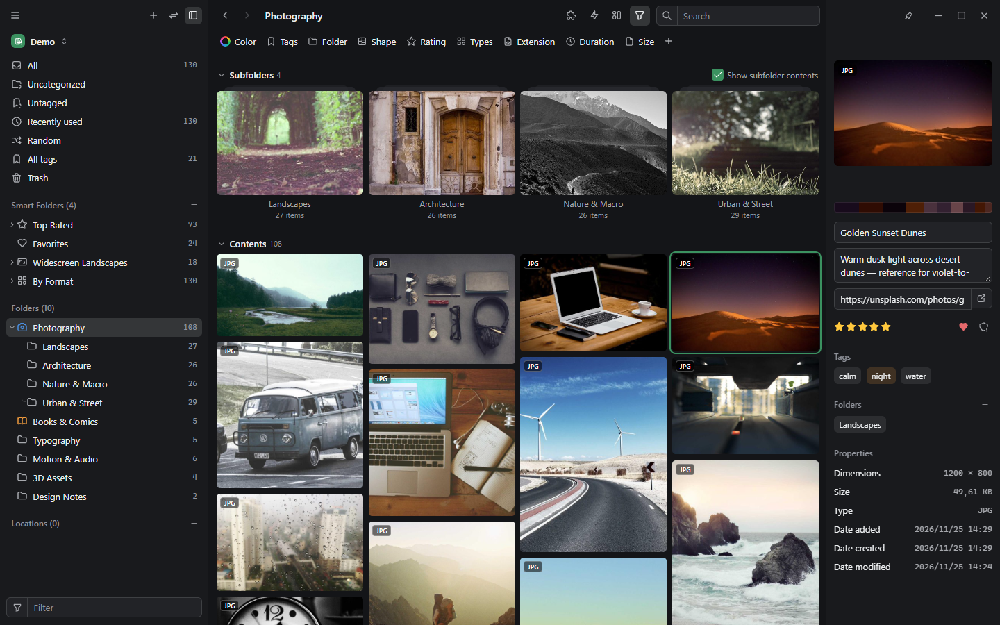
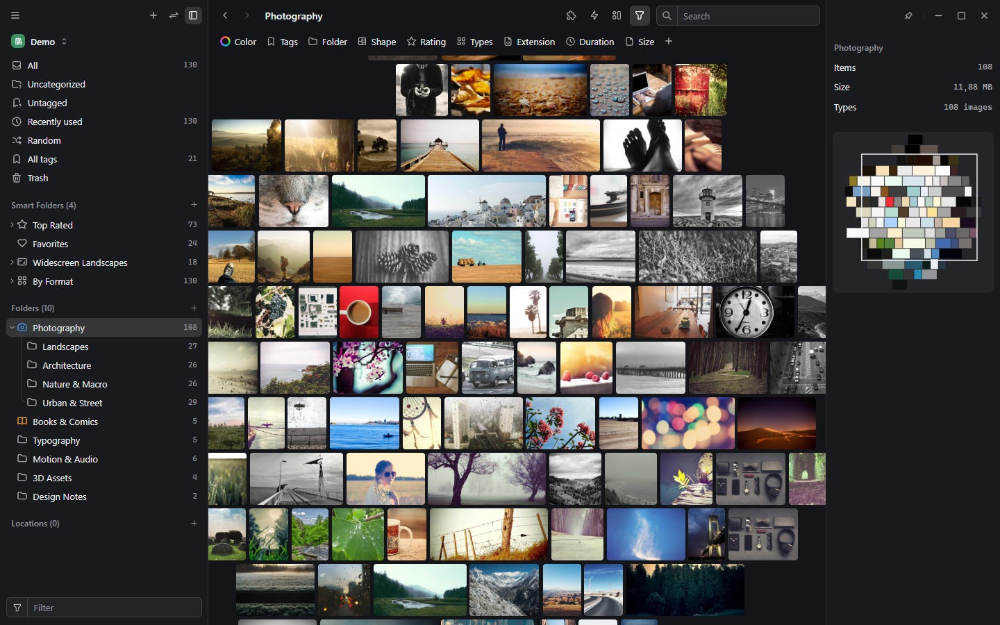
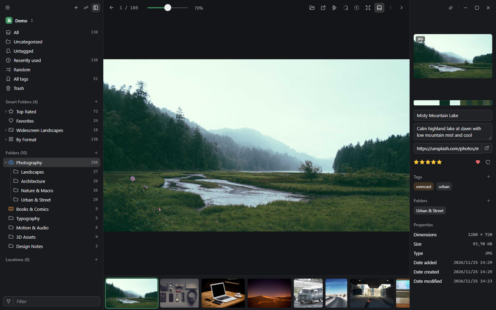
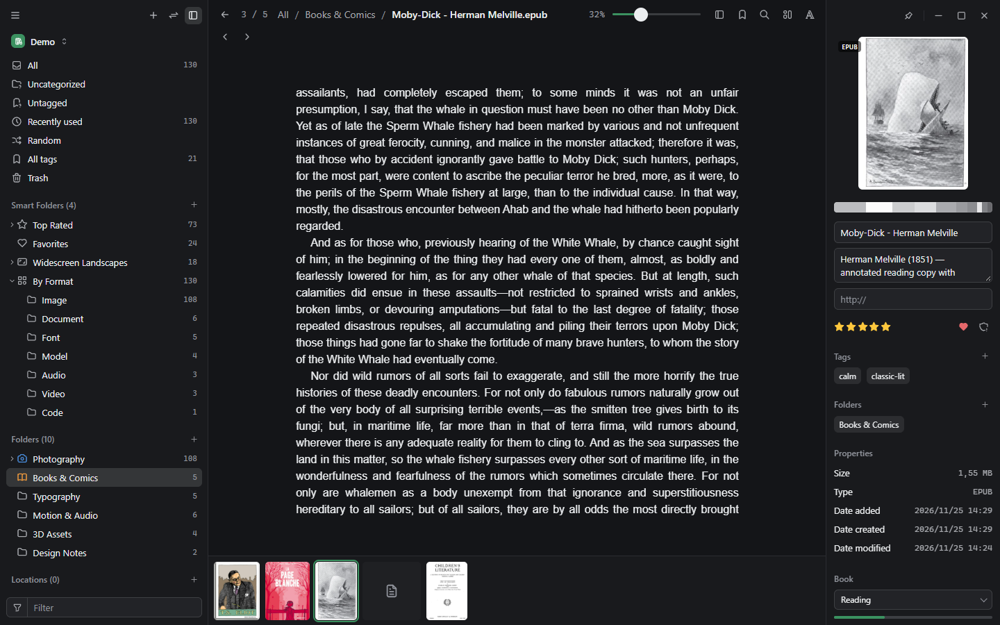
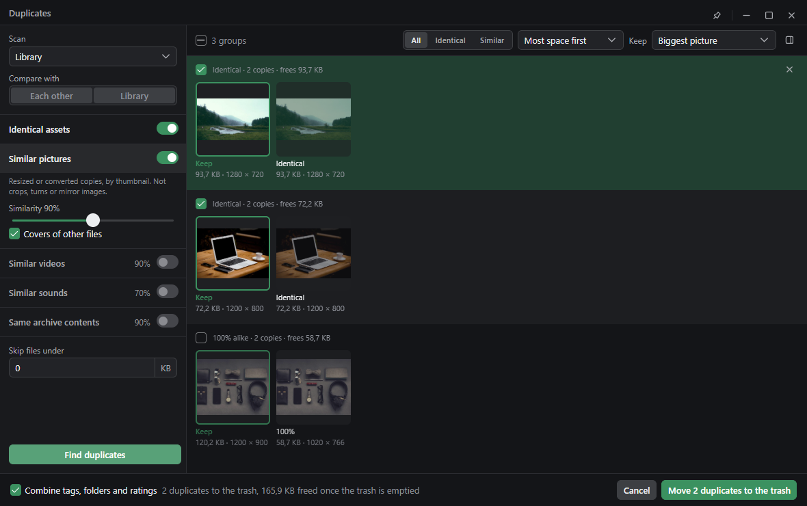
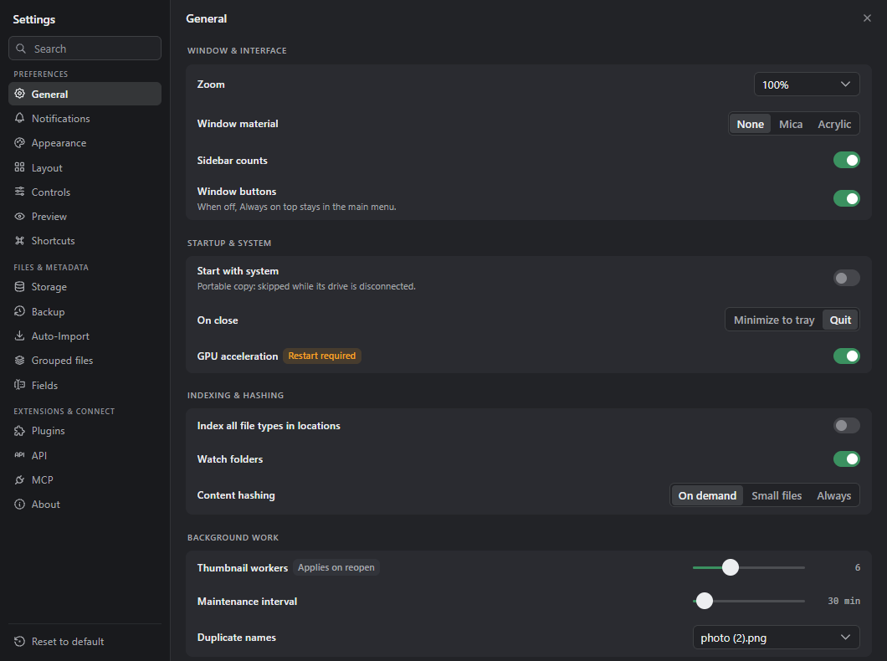
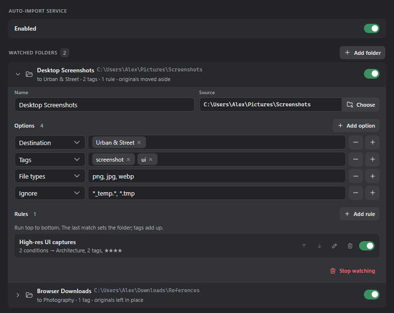
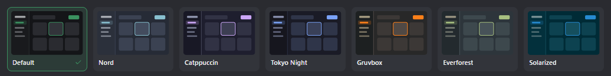

  

# Curio

**A local-first digital asset manager.** Organize images, video, audio, documents, books, fonts, 3D models, code and web links while your files stay where you expect them.

[Docs](https://erehr.github.io/curio/) · [Data Ownership](#data-ownership) · [Features](#features) · [Screenshots](#screenshots) · [API, MCP and Plugins](#api-mcp-and-plugins) · [Installation](#installation) · [Companions](#companion-repositories) · [License](#credits-and-license)

---

## Data Ownership

Curio runs on a native Rust and SQLite engine with a Tauri 2 desktop window. Your originals remain ordinary files you can browse, edit or back up from any file manager:

- **Plain files and folders**: Index existing folders in place as **Locations** (**Read-only**, **Edit files** or **Edit and organize** access), or copy assets into managed storage where `files/` mirrors your folder tree with real filenames and hard links.
- **Local and offline**: No account, telemetry, subscription or cloud service. Everything runs on your machine.
- **Open, inspectable metadata**: Library state lives in a standard SQLite database (`library.db`) beside your files, with scheduled backups, integrity checks and export to **JSON**, **CSV** and **`.curio.json` sidecars**.
- **Built-in portable mode**: Start with `--portable` or place a `Curio data` folder beside the executable to keep settings, plugins and relative-path libraries together on a USB drive.
- **Eagle migration**: Inspired by [Eagle](https://eagle.cool), with a built-in `.library` importer for folders, tags, ratings, notes, smart folders and files.
- **Free software under GNU GPL v3**: The desktop app, the JavaScript/TypeScript API client and the starter plugin templates are licensed under the [GNU GPL v3](LICENSE).

---

## Features

### Libraries & Storage
- **Multiple libraries and windows**: Keep separate `.curio` libraries for design, photography, 3D or personal archives, and open multiple libraries or standalone asset windows side by side.
- **Indexed Locations**: Watch existing folders on local disks, removable drives or mounted shares with live filesystem updates, offline status tracking and root relocation.
- **Managed hard-link store**: Placing an asset in multiple library folders creates hard links inside `files/` instead of duplicating bytes on disk, backed by a crash-safe placement journal and recovery tools.
- **Transfers and backups**: Copy or move assets between indexed locations, managed storage and other libraries while keeping tags, folders, custom fields and grouped files. Schedule automatic database backups with retention limits and restore.

### Browse, Views & Color
- **Five layouts**: Switch between **Grid**, **Masonry**, **Justified**, **List** (resizable, reorderable custom field columns and a live **Font sample** column) and **Spectrum**.
- **Spectrum color map**: Explore results arranged continuously by dominant hue and brightness on an interactive 2D color map.
- **Sorting and grouping**: Group assets by type (including plugin display types), extension, date, name, rating, size, location or any indexed custom field.
- **Quick views and Pinned**: Jump to **All**, **Favorites**, **Uncategorized**, **Untagged**, **Recently used**, **Random**, **Missing & offline** and **Trash**, or pin folders, smart folders, tags and location folders under **Pinned**.

### Search, Filters & Smart Folders
- **Prefix search and query language**: Search names, tags and notes as you type, or write structured queries with `AND`/`OR`/`NOT`, numeric and date ranges, regex (`MATCHES`), list operators (`HAS ALL`, `HAS ANY`, `HAS NONE`), paired field filters (`WITH`), color similarity and `NEAR`/`INSIDE` geographic queries.
- **Filter bar**: Narrow results by color, tags, folders, shape, dimensions, rating, favorite/explicit flags, file types, extensions, dates, duration, custom fields and plugin filters, with live result counts and saved filter presets.
- **Smart Folders**: Build rule-based saved queries with nesting, inline query expressions and **Automatic subfolders** grouped by year, month, rating, type, extension, tag or custom field.

### Organize & Automate
- **Folders, Tags and Inspector**: Organize with nested folders (icons, colors and auto-tagging), tags and color-inheriting tag groups, star ratings, Favorites, Explicit thumbnail blur and single or bulk Inspector editing.
- **Custom fields and metadata readers**: Define typed fields (text, whole and decimal numbers, yes/no, dates, single and multi-select, URLs, JSON and file references) alongside built-in EXIF/GPS, audio/video and font readers. Toggle indexing per field; manual edits survive rescans.
- **Grouped files**: Keep related files together as one asset, including Apple Live Photos, RAW + JPEG pairs, XMP sidecars, 3D materials and buffers, AI model previews or manual multi-file groups.
- **Auto-Import and Actions**: Watch folders for new files with subfolder policies and ordered condition/action rules. Build reusable multi-step **Actions** with keyboard shortcuts, and capture media, pages and screenshots from the browser with the [**Send to Curio**](https://github.com/Erehr/curio-extension) extension.

### Built-in Viewers & Tools
- **Images**: Logarithmic 10%–1000% zoom, smooth or pixelated scaling, transparency checkerboard, mirror and rotate (view only or write to file), animated image playback, Live Photo motion and RAW + JPEG switching.
- **Video and audio**: Native playback with FFmpeg transcoding and cached playable copies, hover preview, speed and resume controls, subtitle tracks, waveforms and embedded covers.
- **Text, code, links and fonts**: Line numbers, line wrap, formatted JSON, Markdown source/rendered/side-by-side views, live web link previews and font specimens with glyph and script coverage.
- **Optional official plugins**: Available in [**curio-plugins**](https://github.com/Erehr/curio-plugins): **Reader** (EPUB, PDF, CBZ/CBR/CB7 comics, RTL manga spreads, progress and bookmarks), **3D Models** (glTF/GLB, OBJ, STL, 3MF orbit viewer and mesh stats) and **AI Generation** (ComfyUI/A1111 prompt extraction, paired LoRA weights and `.safetensors` companions).
- **Built-in tools**: **Batch rename** (ordered operations, metadata tokens, counters, presets and undo), **Find duplicates** (exact BLAKE3 hash, perceptual image/video/audio similarity and archive contents) and **Compare** (side-by-side, slider, overlay and difference).

### Customizable Workspace
- **Arrangeable layouts**: Dock, collapse, edge-hover and rearrange zones and widgets per screen (main, folder, tags, viewers) and optionally per library.
- **Themes and styling**: Seven built-in dark and light theme families (Default, Nord, Catppuccin, Tokyo Night, Gruvbox, Everforest, Solarized), live theme editor, Custom CSS, typography and density controls, Windows 11 Mica/Acrylic materials, shortcut rebinding and notification sounds.

---

## Screenshots

| | |
|---|---|
|  **Spectrum color map**: Explore results radially by dominant hue and brightness with a live minimap. |  **Built-in viewer**: Logarithmic zoom, transforms, thumbnail strip and live Inspector metadata. |
|  **Curio Reader plugin**: Reflowable EPUB, PDF and comic reader with progress tracking, bookmarks and cover thumbnails. |  **Find duplicates**: Exact BLAKE3 hashes and perceptual image, video, audio and archive matching with metadata merge. |
|  **Searchable Settings**: Application and per-library pages covering storage, fields, plugins, API and MCP. |  **Auto-Import rules**: Watch local folders with subfolder policies, ignore patterns and ordered condition/action rules. |

**Built-in themes**: Seven dark and light theme families with a live 15-token editor, Windows 11 Mica/Acrylic materials and CSS import/export.

---

## API, MCP and Plugins

- **Local HTTP API**: 164 operations and 24 Server-Sent Events on a single loopback port (`127.0.0.1:41733`), protected by scoped bearer tokens with permission presets, library allowlists and origin pinning, plus a zero-dependency JavaScript/TypeScript client served by the app (`curio.js` / `curio.d.ts`).
- **Built-in MCP server**: Connect AI assistants over Streamable HTTP (`POST /mcp`) with per-tool allowlists and token scoping.
- **Sandboxed plugin system**: Extend Curio with `plugin.json` manifests, sandboxed HTML/JS pages (widgets, tabs, windows, custom viewers, settings pages, thumbnailers and extractors) and native CLI programs for actions, URL handlers and background jobs.

---

## Installation

Download builds from [GitHub Releases](https://github.com/Erehr/curio/releases) or see the [Install guide](https://erehr.github.io/curio/start/install/) for full details:

- **Windows**: Run `Curio_<version>_x64-setup.exe` (no administrator rights required), or extract the portable ZIP and run `Curio.exe`. Both bundle FFmpeg.
- **Linux (`.deb`)**: `sudo apt install ./Curio_<version>_amd64.deb` (FFmpeg and GStreamer plugins come from your distribution).
- **Linux (`.rpm`)**: `sudo dnf install ./Curio-<version>-1.x86_64.rpm` (uses system FFmpeg and GStreamer).
- **Linux (AppImage)**: Make executable (`chmod +x Curio_<version>_amd64.AppImage`) and run. Carries GStreamer plugins and uses system `ffmpeg`.
- **macOS**: A `.dmg` for Apple Silicon or Intel, macOS 12 Monterey or later with Safari 16.4 or later. Bundles FFmpeg. The app is ad-hoc signed and not notarized: after dragging **Curio.app** into `/Applications`, run `xattr -cr /Applications/Curio.app` once or choose **Open Anyway** in **System Settings › Privacy & Security**.

### Settings & Portable Mode

By default, Curio stores application settings and default libraries in your OS user directories:

- **Windows**: `%APPDATA%\Curio` (settings, default libraries and app-level plugins)
- **Linux**: `~/.config/Curio` (settings) and `~/.local/share/Curio` (default libraries and app-level plugins)
- **macOS**: `~/Library/Application Support/Curio` (settings, default libraries and app-level plugins)

For a self-contained portable setup (such as a USB drive), launch once with `--portable` or create a `Curio data` folder next to `Curio.exe` (Windows) or the `.AppImage` / binary (Linux). Libraries on the same drive are stored with relative paths so they stay reachable across drive-letter changes. See [Storage](docs/features/libraries/storage.md).

---

## Documentation

Browse the full documentation site at **[erehr.github.io/curio](https://erehr.github.io/curio/)** (built with [Zensical](https://zensical.org) from [`docs/`](docs/)):

| Section | Start here | Covers |
|---|---|---|
| **Start** | [Install](https://erehr.github.io/curio/start/install/) · [First library](https://erehr.github.io/curio/start/first-library/) · [Window](https://erehr.github.io/curio/start/window/) | Setup, first library walkthrough, workspace overview and terminology. |
| **Features** | [Features guide](https://erehr.github.io/curio/features/) | Libraries, storage, import/export, organization, views, Spectrum, search, smart folders, viewers, tools, customization and recovery. |
| **API & MCP** | [API overview](https://erehr.github.io/curio/api/) · [Query syntax](https://erehr.github.io/curio/api/query/syntax/) · [MCP](https://erehr.github.io/curio/api/connect/mcp/) | HTTP endpoints, tokens, JS/TS client, SSE events, MCP setup, types and all 164 operations. |
| **Plugins** | [Plugins overview](https://erehr.github.io/curio/plugins/) · [First plugin](https://erehr.github.io/curio/plugins/start/first-plugin/) · [Manifest](https://erehr.github.io/curio/plugins/manifest/) | Extension points, page runtime, UI kit, native programs, page hooks and `plugin.json` reference. |

To preview the documentation locally, install Zensical (`pip install zensical`) and run `zensical serve` in this folder.

## Companion Repositories

| Repository | Description |
|---|---|
| [**Erehr/curio-plugins**](https://github.com/Erehr/curio-plugins) | Optional official plugins: **Reader** (ebooks, PDFs and comics), **3D Models** (Three.js viewer and geometry fields) and **AI Generation** (prompts, LoRAs and `.safetensors` models). |
| [**Erehr/curio-extension**](https://github.com/Erehr/curio-extension) | **Send to Curio** browser extension for Chrome, Edge and Chromium browsers (drag card, Alt+Click, side panel, screenshots, site rules and offline queue). |

---

## Credits and License

Curio is free software under the **GNU General Public License v3.0** ([LICENSE](LICENSE)). See [LICENSING.md](LICENSING.md) for bundled third-party components and licenses. Each release also includes `Curio-<version>-ffmpeg-source.tar` with the bundled FFmpeg build details and corresponding source.
