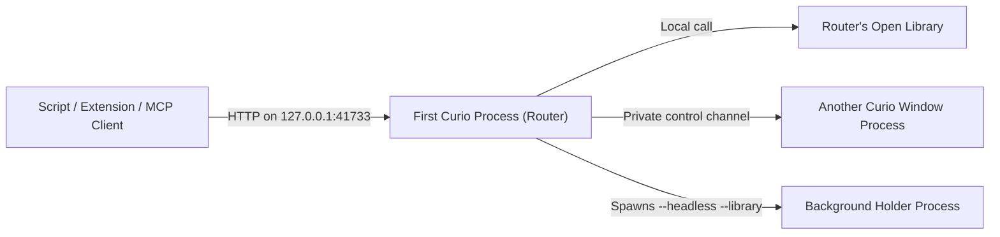

# HTTP

Curio exposes a local HTTP API on `127.0.0.1` for scripts, browser extensions and desktop tools. One loopback endpoint serves every registered operation with the same parameters, permissions and return shapes used by `curio.js`, MCP tools and plugins.



## Setup

Open **Settings › API** to turn the loopback service on or off and choose its TCP port. Curio enables the service by default on port `41733` and binds only to `127.0.0.1`.

| Setting | Default | Behavior |
|---|---|---|
| Enable API | On | Starts the HTTP server on `127.0.0.1` when Curio runs. |
| Port | `41733` | Sets the TCP port for `/api/v1/*` and `/mcp`. |
| Open from the browser | On | Registers the `curio://` launch scheme on this computer; see [Launch links and browser pairing](launch-pair.md). |

Each open library runs in its own OS process. The first Curio process to bind the configured port routes requests for every library on the computer. It forwards each call over the target process's private loopback control channel. When the router process exits, another running Curio process claims the port within a few seconds.

To block DNS rebinding from remote websites, Curio checks the `Host` header on every request. The header must match `127.0.0.1:<port>`, `localhost:<port>` or `[::1]:<port>` (case-insensitive). Curio rejects any other `Host` value with HTTP `403` (`not_allowed`).

## GET /api/v1/ping

`GET /api/v1/ping` checks whether Curio is listening on the port. It needs no token, allows any origin (`Access-Control-Allow-Origin: *`) and returns a small JSON payload revealing nothing beyond what a port check shows.

=== "HTTP"

    ```http
    GET /api/v1/ping HTTP/1.1
    Host: 127.0.0.1:41733
    ```

    ```json
    {
      "name": "Curio",
      "apiVersion": 1
    }
    ```

=== "JavaScript"

    ```js
    const res = await fetch('http://127.0.0.1:41733/api/v1/ping')
    const info = await res.json()
    // { name: 'Curio', apiVersion: 1 }
    ```

=== "Python"

    ```python
    import requests
    info = requests.get("http://127.0.0.1:41733/api/v1/ping", timeout=1).json()
    assert info["name"] == "Curio"
    ```

Curio's [`curio://open?background=1`](launch-pair.md#curioopenbackground1) launcher checks this endpoint first and exits if Curio already answers. For version, platform and language details, authenticate and call [`app.info`](../operations/app.md#app-info).

## GET /api/v1/curio.js

`GET /api/v1/curio.js` serves Curio's standalone JavaScript client (`Content-Type: text/javascript; charset=utf-8`, `Access-Control-Allow-Origin: *`). It requires no token and contains no secrets.

- **Local web pages**: Include it with `<script src="http://127.0.0.1:41733/api/v1/curio.js"></script>`.
- **Node.js and browser extensions**: Bundle or download a copy from this endpoint to match the installed Curio version.

See [JavaScript and TypeScript client](client.md) for the full client reference.

## GET /api/v1/curio.d.ts

`GET /api/v1/curio.d.ts` serves the generated TypeScript declarations (`Content-Type: text/plain; charset=utf-8`, `Access-Control-Allow-Origin: *`) from Curio's live operation registry. It requires no token.

Save it beside your script and add `/// <reference path="curio.d.ts" />` for editor completion and type checking across `Curio.connect`, every operation and `Curio.EventMap`.

## `POST /api/v1/<namespace>/<method>`

Call any API operation by sending an HTTP `POST` to `/api/v1/` with each dot in the operation name replaced by a slash:

| Operation name | HTTP endpoint |
|---|---|
| `app.info` | `POST /api/v1/app/info` |
| `item.query` | `POST /api/v1/item/query` |
| `item.add.fromUrls` | `POST /api/v1/item/add/fromUrls` |
| `library.grouping.survey` | `POST /api/v1/library/grouping/survey` |
| `tagGroup.addTags` | `POST /api/v1/tagGroup/addTags` |

=== "HTTP"

    ```sh
    curl -s http://127.0.0.1:41733/api/v1/item/query \
      -H "Authorization: Bearer $CURIO_TOKEN" \
      -H "Content-Type: application/json" \
      -d '{"query": "tag = sky AND rating >= 4", "limit": 10}'
    ```

=== "JavaScript"

    ```js
    const Curio = require('./curio.js') // Downloaded from /api/v1/curio.js
    const curio = Curio.connect({ token: process.env.CURIO_TOKEN })
    const page = await curio.item.query({ query: 'tag = sky AND rating >= 4', limit: 10 })
    ```

=== "Python"

    ```python
    import os, requests

    res = requests.post(
        "http://127.0.0.1:41733/api/v1/item/query",
        headers={"Authorization": f"Bearer {os.environ['CURIO_TOKEN']}"},
        json={"query": "tag = sky AND rating >= 4", "limit": 10},
    )
    res.raise_for_status()
    page = res.json()
    ```

=== "MCP"

    ```json
    {
      "jsonrpc": "2.0",
      "id": 1,
      "method": "tools/call",
      "params": {
        "name": "item_query",
        "arguments": { "query": "tag = sky AND rating >= 4", "limit": 10 }
      }
    }
    ```

**Default library query parameter (`?library=`):**

- **Setting a default**: Append `?library=<id-or-name-or-path>` to the URL to supply a fallback target library.
- **Body precedence**: A `library` property inside the JSON body always overrides `?library=`.
- **`App`-targeted operations**: Operations targeting `App` (such as [`app.info`](../operations/app.md#app-info) or [`library.list`](../operations/libraries.md#library-list)) ignore `?library=`, so callers can append a default library to every URL without error.

Other HTTP endpoints on the same loopback server:

| Endpoint | Method | Purpose |
|---|---|---|
| `/api/v1/pair` | `POST` | Runs unauthenticated browser extension pairing; see [Launch links and browser pairing](launch-pair.md#post-apiv1pair). |
| `/api/v1/upload?name=<filename>` | `POST` | Spools binary uploads up to 2 GiB for [`item.add.fromBytes`](../operations/item-add.md#item-add-frombytes); see [Files and uploads](files.md). |
| `/api/v1/events` | `POST` | Opens the Server-Sent Events stream; see [Events](events.md). |
| `/mcp` | `POST` | Serves the Streamable HTTP Model Context Protocol (off by default); see [MCP](mcp.md). |

Curio answers requests outside `/api/v1/` and `/mcp` with HTTP `404` (`not_found`). Non-`POST` methods on operation endpoints (other than `OPTIONS` preflight and the three `GET` routes) return HTTP `400` (`bad_request`).

## Headers & bodies

| Header | Required | Rules |
|---|---|---|
| `Host` | Yes | Must match `127.0.0.1:<port>`, `localhost:<port>` or `[::1]:<port>`. |
| `Authorization` | Yes (except discovery and `/pair`) | `Bearer <token>` (scheme matched case-insensitively). |
| `Content-Type` | When body is non-empty | Must be `application/json` (parameters such as `; charset=utf-8` are allowed) for operations, `/events` and `/mcp`. Curio rejects plain-text `POST` bodies so websites cannot skip CORS preflight. Send raw bytes (such as `application/octet-stream`) to `/api/v1/upload`. |
| `Last-Event-ID` | Optional (`/events` only) | Resumes the SSE stream after the given event ID. |

**Body limits and concurrency:**

| Rule | Limit or behavior |
|---|---|
| JSON body size | Capped at **64 MiB** to hold base64 payloads for [`item.add.fromBytes`](../operations/item-add.md#item-add-frombytes). Send larger files to [`POST /api/v1/upload`](files.md#uploads). |
| Empty request bodies | Empty or whitespace-only bodies default to `{}` and need no `Content-Type` header. Any non-empty JSON body must decode to a JSON object (`400 bad_request` otherwise). |
| Concurrent HTTP requests | At most **8** requests run at once. Excess requests receive plain-text HTTP `503` (`Too many requests at once`) rather than a JSON error envelope. |
| Concurrent SSE streams | At most **16** event streams run at once, tracked separately from HTTP requests. Excess streams return HTTP `503` with the JSON `busy` error envelope. |

**Responses:**

- **JSON operations**: Return HTTP `200` with `Content-Type: application/json` and the operation result.
- **Binary operations**: [`item.thumbnail`](../operations/item-files.md#item-thumbnail), [`item.file`](../operations/item-files.md#item-file) and [`archive.entry`](../operations/archive.md#archive-entry) return HTTP `200` with raw bytes and the detected `Content-Type`.
- **Errors**: Return HTTP `400`, `401`, `403`, `404`, `409`, `413`, `422` or `503` with `{"error": {"code": "...", "message": "..."}}` (except the plain-text `503` concurrency limit above). See [Errors](errors.md).

## CORS & origins

Curio treats requests without an `Origin` header (such as `curl`, Python, Node.js or desktop scripts) as local programs requiring only a valid token. When a browser or extension includes an `Origin` header, Curio applies four checks:

1. **Preflight (`OPTIONS`)**: Curio answers HTTP `204 No Content` with these headers:
   - `Access-Control-Allow-Origin: <Origin>`
   - `Access-Control-Allow-Methods: GET, POST`
   - `Access-Control-Allow-Headers: Authorization, Content-Type, Last-Event-ID`
   - `Access-Control-Allow-Private-Network: true` (satisfies Chromium Private Network Access)
   - `Access-Control-Max-Age: 600`
   - `Vary: Origin`
2. **Loopback origins**: Curio always permits `http://` and `https://` pages on `127.0.0.1`, `localhost` or `[::1]` (any port), ignoring token origin lists.
3. **Non-loopback origins** (websites and extensions such as `chrome-extension://<id>` or `moz-extension://<uuid>`):
   - An empty `origins` list permits any origin.
   - A non-empty `origins` list requires a case-insensitive match after stripping trailing `/`; mismatches fail with HTTP `403` (`not_allowed`).
4. **Response CORS headers**: Curio echoes `Access-Control-Allow-Origin` and `Vary: Origin` on success and error responses so browser code can read errors. Curio never uses cookies or `Access-Control-Allow-Credentials`. Authentication uses only `Authorization: Bearer`.

