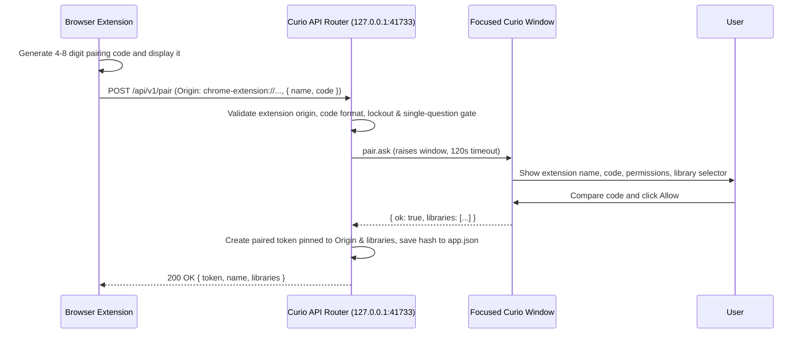

# Launch & pair

Curio gives browser extensions and desktop launchers two ways to connect without asking users to copy secrets by hand. `curio://` links start or focus the app, and `POST /api/v1/pair` issues an origin-pinned token after user approval.

## `curio://open`

`curio://open` launches Curio normally. If Curio is already running, it brings the most recently used library window to the front.

| Condition | Result |
|---|---|
| Curio is not running | Launches Curio and opens the last library in a window. |
| Curio is already running | Focuses and raises the last library's window. |
| Unrecognized `curio://...` path or link longer than 2,048 characters | Falls back to `curio://open`. |

Because any website can publish a `curio://` link, launch links never add, change or delete data and never accept tokens, file paths or CLI flags. When started with a `curio:` argument, Curio drops all other CLI flags and paths (`--portable`, `--library`, `--screenshot`) and handles only the first link.

## `curio://open?background=1`

`curio://open?background=1` (or `background=true`) starts Curio in the system tray on Windows and Linux, or in the menu bar on macOS. Browser extensions use it to wake the local API without stealing focus.

- Before opening a library, Curio checks `GET /api/v1/ping` on the configured API port. If another Curio process already answers, the launcher process exits immediately and leaves existing windows untouched.
- If Curio is not running, it opens the last library in the tray (menu bar on macOS) so the API answers `GET /api/v1/ping`.

## `curio://library/<id>`

`curio://library/<id>` opens a specific library in its own window, or raises that window if already open.

- `<id>` must be a valid library ID from [`library.list`](../operations/libraries.md#library-list): 1 to 64 ASCII hexadecimal digits or hyphens (`[0-9a-fA-F-]`).
- If `<id>` fails validation, Curio treats the link as `curio://open`.

## Register handler

Curio registers the `curio:` URL scheme per user on startup and updates the registration if the executable moves:

| Platform | Registration location | Behavior / entry |
|---|---|---|
| Windows | `HKCU\Software\Classes\curio` | Sets `URL Protocol`, `DefaultIcon` and `shell\open\command` to `"<exe>" "%1"`. |
| Linux (packaged) | `/usr/share/applications/curio-url.desktop` | Installed by the system package; Curio leaves the system file untouched. |
| Linux (AppImage or manual build) | `$XDG_DATA_HOME/applications/curio-url.desktop` | Writes `MimeType=x-scheme-handler/curio;` with `Exec="<exe>" %u` (pointing to `$APPIMAGE` for AppImages) and runs `xdg-mime default curio-url.desktop x-scheme-handler/curio`. |
| macOS | App bundle `Info.plist` (`CFBundleURLTypes`), registered by macOS on first open | macOS delivers `curio://` links through Apple events. Curio handles them on cold launch and routes links received while running through the same handler path as Windows and Linux. |

**When registration is skipped or removed:**

- **Settings toggle**: Turning off **Open from the browser** in **Settings › API** removes the user-level registry key or desktop file. On macOS, the bundle keeps the scheme and Curio ignores incoming links.
- **Portable copies**: Portable builds never register the scheme, so a temporary or sandbox copy does not override an installed handler.
- **Headless mode**: Headless starts (`--headless`) do not register the scheme.
- **Debug builds**: Debug builds skip registration unless `CURIO_REGISTER_SCHEME=1` is set.

## `POST /api/v1/pair`

`POST /api/v1/pair` is the only unauthenticated `POST` endpoint on the web API. A browser extension sends its display name and a numeric verification code to request a paired token.



=== "HTTP"

    ```http
    POST /api/v1/pair HTTP/1.1
    Host: 127.0.0.1:41733
    Origin: chrome-extension://chfhdgecmnomfokannimcbbjgghdmejg
    Content-Type: application/json

    {
      "name": "Send to Curio (Chrome)",
      "code": "4821"
    }
    ```

    ```json
    {
      "token": "curio_9f2a1c...",
      "name": "Send to Curio (Chrome)",
      "libraries": ["3f8b1c2d-4e5f-6a7b-8c9d-0e1f2a3b4c5d"]
    }
    ```

=== "JavaScript"

    ```js
    const code = String(Math.floor(1000 + Math.random() * 9000))
    showCodeToUser(code)

    const res = await fetch('http://127.0.0.1:41733/api/v1/pair', {
      method: 'POST',
      headers: { 'Content-Type': 'application/json' },
      body: JSON.stringify({ name: 'Send to Curio (Chrome)', code }),
    })
    const body = await res.json()
    if (!res.ok) throw new Curio.Error(body.error.code, body.error.message, res.status)
    // body = { token, name, libraries }
    ```

**Request body parameters:**

| Field | Type | Required | Rules |
|---|---|---|---|
| `name` | `string` | No | Display name shown in the prompt and saved on the token. Curio replaces control characters with spaces, collapses whitespace and truncates to 60 characters (default `"Browser extension"`). |
| `code` | `string` | Yes | 4 to 8 ASCII digits (`0`-`9`) shown by the extension so the user can confirm the prompt matches. |

**Response fields (HTTP `200`):**

| Field | Type | Description |
|---|---|---|
| `token` | `string` | Plaintext `curio_...` secret returned once. If sending the HTTP response fails, Curio deletes the new token immediately. |
| `name` | `string` | Normalized token name stored in **Settings › API**. |
| `libraries` | `string[]` | Library IDs approved by the user; `[]` means all libraries on this computer. |

## Pairing flow

Curio validates the `Origin` header on every `POST /api/v1/pair` request:

- **Allowed origins**:
  - `chrome-extension://<id>` where `<id>` is 32 lowercase letters `a` through `p`.
  - `moz-extension://<uuid>` where `<uuid>` is a hyphenated `8-4-4-4-12` hex UUID.
- **Refused origins**: Web pages (`http://`, `https://`), requests without an `Origin` header and all other schemes fail with HTTP `403` (`not_allowed`).

When a valid pairing request arrives:

1. If the router process owns a window, Curio raises it and opens the pairing prompt directly. Otherwise, the router forwards the prompt to the most recently focused Curio window.
2. The prompt shows the extension's `name`, `code`, fixed permission summary and library selector (all libraries or specific libraries).
3. When the user clicks **Allow**, Curio creates a `paired: true` token pinned to the extension's `Origin` and chosen libraries. The token receives `library.read`, `metadata.read`, `metadata.write`, `organize` and `files.write`, subject to the [paired token deny list](authorization.md#extension-limits).

## Errors & disconnect

| Condition | HTTP status | Error `code` | Details |
|---|---|---|---|
| Invalid or missing extension `Origin` | `403` | `not_allowed` | Only `chrome-extension://` and `moz-extension://` origins can pair. |
| Malformed JSON or invalid `code` | `400` | `bad_request` | `code` must contain 4 to 8 ASCII digits. |
| No Curio window is open | `409` | `no_window` | Background holders cannot approve pairing; open a Curio window first. |
| Another pairing prompt is open | `503` | `busy` | Curio allows only one pairing prompt at a time. |
| Window is showing another modal prompt | `503` | `busy` | Retry after the user closes the active prompt. |
| User clicks **Deny** or closes the dialog | `403` | `not_allowed` | Counts as a refusal (`"Not allowed in Curio"`). |
| No response within **120 seconds** | `403` | `not_allowed` | Counts as a refusal (`"Nobody answered in Curio"`). |
| **3 refusals in a row** | `403` | `not_allowed` | Locks pairing for **10 minutes**. An approval resets the counter to `0`. |

**Disconnecting an extension:**

When the user clicks **Disconnect**, the extension calls [`token.forget`](../operations/credentials.md#token-forget) with its bearer token and clears local storage. If Curio is offline during disconnect, the extension clears local state and tells the user to delete the token manually in **Settings › API**.
