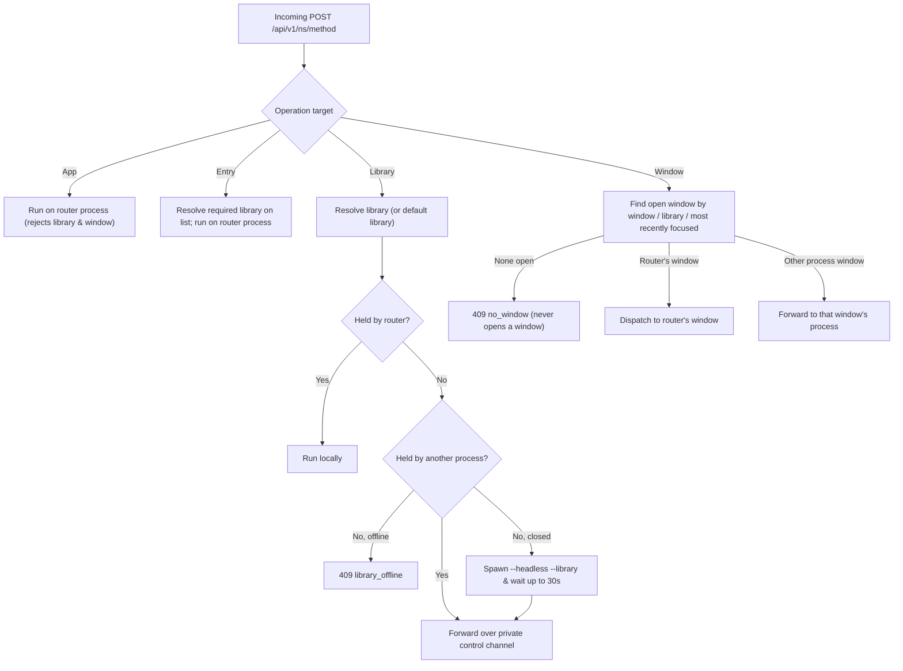

# Routing

Curio runs one OS process per open library while serving one loopback API port. Every operation declares a **target** (`App`, `Entry`, `Library` or `Window`) that tells the router how to resolve, open or forward the request.

## Targets

Every operation in Curio's registry belongs to one of four target classes:

| Target | `library` parameter | `window` parameter | Where it executes | Examples |
|---|---|---|---|---|
| `App` | Rejected (`400 bad_request` in body; ignored if sent via `?library=`) | Rejected (`400 bad_request`) | On the router process | [`app.info`](../operations/app.md#app-info), [`app.operations`](../operations/app.md#app-operations), [`app.fonts`](../operations/app.md#app-fonts), [`library.list`](../operations/libraries.md#library-list), [`library.create`](../operations/libraries.md#library-create), [`token.forget`](../operations/credentials.md#token-forget), [`job.list`](../operations/job.md#job-list), [`tool.list`](../operations/tool.md#tool-list), [`clipboard.readText`](../operations/clipboard.md#clipboard-readtext), [`clipboard.writeText`](../operations/clipboard.md#clipboard-writetext) |
| `Entry` | **Required** (`400 bad_request` if omitted) | Rejected (`400 bad_request`) | On the router process against this computer's library list (open or closed) | [`library.open`](../operations/libraries.md#library-open), [`library.rename`](../operations/libraries.md#library-rename), [`library.forget`](../operations/libraries.md#library-forget), [`library.place`](../operations/libraries.md#library-place), [`library.setLook`](../operations/libraries.md#library-setlook) |
| `Library` | Optional (uses default library) | Rejected (`400 bad_request`) | On the process holding that library (spawns a background holder if closed) | All `item.*`, `folder.*`, `smartFolder.*`, `tag.*`, `tagGroup.*`, `field.*`, `location.*`, `query.*`, `archive.*`, `duplicates.*`, [`library.info`](../operations/libraries.md#library-info), [`library.stats`](../operations/libraries.md#library-stats), [`library.grouping.*`](../operations/library-grouping.md#library-grouping), [`clipboard.copyFiles`](../operations/clipboard.md#clipboard-copyfiles) |
| `Window` | Optional (matches window showing that library) | Optional (matches window ID) | On the process owning that window (never opens a window) | [`app.theme`](../operations/app.md#app-theme), [`app.openUrl`](../operations/app.md#app-openurl), [`library.switch`](../operations/libraries.md#library-switch), `selection.*`, `view.*`, `viewer.*`, `ui.*`, `dialog.*` |

## Library selector

When a caller passes `library` (in the JSON body or `?library=`), Curio resolves it against known libraries and the router's open library in order:

1. **Exact library `id`**: Matches the stable UUID returned by [`library.list`](../operations/libraries.md#library-list). Curio stores this ID in the library database so it survives renames and folder moves. A library that has never been opened on this computer has `id: null` until first opened.
2. **Exact folder path**: Normalizes `/` separators, strips trailing slashes and compares case-insensitively on Windows.
3. **Unique library name**: Matches the library's display name (folder stem without `.curio`) case-insensitively. If two libraries share the same name, Curio returns HTTP `404` (`unknown_library`: `"Several libraries are called <name>; use the id from library.list"`).

If no library matches, Curio returns HTTP `404` (`unknown_library`). If the token restricts allowed libraries and the match is unlisted, Curio returns HTTP `403` (`not_allowed`).

!!! tip "Prefer the stable ID"
    Store and pass `library.id` in automation scripts and extensions. Use paths or names only for quick interactive calls or libraries whose `id` is still `null`.

## Default library

When a `Library`-targeted call omits `library`, Curio picks a default library in this order:

1. The open windowed library whose window was most recently focused.
2. Among open windowed libraries with no focus timestamp, the window opened most recently.
3. If no windowed library is open, the most recently focused or opened background holder.
4. If no library is open, the last library opened in a window on this computer, provided its folder is reachable on disk.
5. If none exist, Curio returns HTTP `409` (`library_closed`).

[`library.list`](../operations/libraries.md#library-list) marks the active default with `"default": true`.

## Background open

When a `Library`-targeted call resolves to a closed library whose `.curio` folder exists on disk:

1. The router spawns a headless background holder process (`curio --headless --library <folder>`).
2. Concurrent calls to the same library share that startup wait instead of launching duplicate processes.
3. Curio waits up to **30 seconds** for the holder to announce its control port. On timeout, Curio returns HTTP `503` (`busy`).
4. Once open, the background holder answers API calls, streams events to the router and runs its scan, metadata and thumbnail queues.
5. If an idle holder is shutting down as a call arrives, the router waits for it to exit and retries once with a fresh holder.
6. After **1 minute** with no API calls, no open event streams and no queued background work, the background holder exits.

If the user opens that library in Curio while a background holder is running, the holder shows its window instead of starting a second process. If the library folder is unreachable (such as an unplugged drive), Curio returns HTTP `409` (`library_offline`) immediately.

!!! note "WebView-dependent media tasks"
    Thumbnails and durations that require the desktop WebView player (such as video or audio without FFmpeg) wait until the library opens in a visible window.

## Window selector

`Window`-targeted operations (`selection.*`, `view.*`, `viewer.*`, `ui.*`, `dialog.*`, [`app.theme`](../operations/app.md#app-theme), [`app.openUrl`](../operations/app.md#app-openurl) and [`library.switch`](../operations/libraries.md#library-switch)) never open a closed library and never show a window for a background holder:

| Parameters provided | Resolution rule | Error if unmatched |
|---|---|---|
| `window` only | Matches the open window with that `window` ID from [`library.list`](../operations/libraries.md#library-list). A window keeps its ID across [`library.switch`](../operations/libraries.md#library-switch). | `404 not_found` |
| Both `window` and `library` | Matches the window by ID and verifies it currently displays `library`. | `404 not_found` (unknown window) or `400 bad_request` (window shows another library) |
| `library` only | Finds the visible window currently showing that library. | `409 no_window` (even if a background holder is open) |
| Neither | Picks the most recently focused visible window whose library the token can reach. | `409 no_window` |

[`item.open`](../operations/item-open.md#item-open) and [`item.reveal`](../operations/item-open.md#item-reveal) target `Library`, not `Window`, so Curio routes them to the item's library first. Calling `item.open` with `how: "viewer"` or `how: "window"` then needs a visible window for that library and returns `409 no_window` for background holders.

**Window timeouts:**

- **Non-interactive window calls**: Wait up to **15 seconds** (**60 seconds** for [`library.switch`](../operations/libraries.md#library-switch)) before returning `503 busy`.
- **Interactive prompts** (`ui.confirm`, `ui.prompt`, `ui.pick*`, `ui.menu`, `dialog.*`, `app.openUrl`): Raise the window, show the caller's token or plugin name and allow one prompt per window at a time (`503 busy` for concurrent prompts). They wait up to **10 minutes** (`600 seconds`).

## Plugin defaults

Curio pins every plugin page and plugin program to the library and window context that launched it:

- **Forbidden selectors**: Passing `library` on a `Library` operation, or passing `library` or `window` on a `Window` operation, fails with HTTP `403` (`not_allowed`).
- **Library operations**: Always run against the library held by the process that launched the plugin.
- **Cross-library copy and move**: A plugin holding `files.write` can still pass a destination library in `to` for [`item.copyToLibrary`](../operations/item-lifecycle.md#item-copytolibrary) or [`item.moveToLibrary`](../operations/item-lifecycle.md#item-movetolibrary). That parameter is an operation argument, not the target `library`.

**Window routing for plugins:**

| Plugin host context | `ui.*` and `dialog.*` prompts | `selection.*`, `view.*` and `viewer.*` calls |
|---|---|---|
| Page inside the `"main"` library window | Run in the `"main"` window. | Run in the `"main"` window. |
| Page inside its own plugin window | Open over the plugin window itself. | Act on the library's `"main"` window. |
| Plugin program in a headless background holder | Return `409 no_window`. | Return `409 no_window`. |
