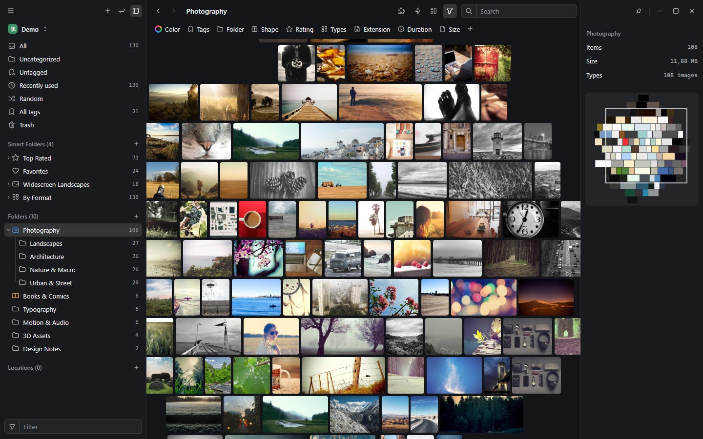

# Spectrum

**Spectrum** is Curio's 2D color map view. It arranges assets radially by dominant hue and brightness so related palettes cluster together.

<figure class="curio-shot" markdown>

<figcaption>Spectrum arranging a folder of photographs by dominant hue and lightness, with the viewport minimap in the Inspector.</figcaption>
</figure>

## Open

Switch to **Spectrum** from the **Layout** popover or its toolbar shortcut in any scope: **All**, **Favorites**, a **Folder**, a **Smart folder**, a **Location** or search results.

- Spectrum respects active **Filter bar** filters and your **Search** query.
- When **Show subfolders** is on, subfolder cards form a centered 4:3 cluster inside a ring at the center of the wheel. Cards are ordered by cover color (or folder color) to match the surrounding hues.
- Toggle **Show subfolder contents** in the **Layout** popover to switch between direct assets and recursive subfolder contents.

## Color map

- **Angle (Hue)**: Assets arrange around 360° by primary palette hue (reds, oranges, yellows, greens, cyans, blues, violets and magentas).
- **Radius (Lightness and saturation)**: Neutral, grayscale, dark and bright palettes separate from vivid hues.
- **Zoom and pan**:
  - **Mouse wheel**: Zooms around the pointer without holding ++ctrl++.
  - **Middle-click drag**: Drag with the middle button, drag empty canvas or use scrollbars to pan on both axes.
  - **Arrow keys**: Move selection to neighboring assets in 2D space, panning only as far as needed to reveal off-screen selections.
  - **Minimap**: Shows your viewport across the full color map so you can click to jump to another cluster in large libraries.

## Inspect & open

Spectrum supports the same selection, preview and drag-and-drop actions as Grid view:

- **Single click**: Selects an asset or subfolder card and loads its metadata and palette in the **Inspector**. Use ++ctrl+click++ to toggle multi-selection.
- **Double-click or ++enter++**: Opens the asset in the viewer or opens a subfolder.
- **Hover playback**: Hovering over video, audio, Live Photos or animated images plays previews inside Spectrum, including video scrubbing and audio waveform seeking. Panning or dragging stops playback.
- **Drag and drop**: Drag assets from Spectrum onto sidebar folders, tags, centered subfolder cards or external apps. Assets flagged **Explicit** stay blurred in Spectrum as in Grid view.

## Missing palettes

Assets without an extracted color palette, and non-visual formats without a rendered preview, sit outside the color map or appear once thumbnail and palette workers finish.

## Refresh

- If an asset's thumbnail changed or its color position looks wrong, right-click it and choose **More › Refresh colors** (or call [`item.refreshPalette`](../../api/operations/item-files.md#item-refreshpalette)).
- On libraries with tens of thousands of assets, narrow the view with **Types**, a **Folder**, a **Tag** or **Color** so Spectrum maps a focused subset.
