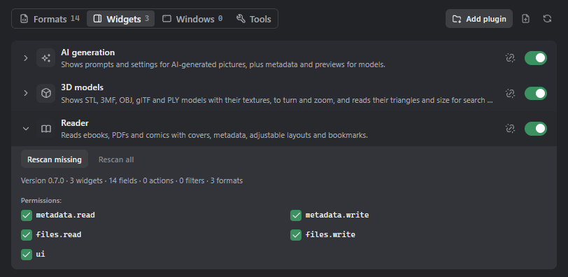

# Plugins

Open **Settings › Plugins** to manage built-in format families, add external plugins, adjust permissions, configure CLI tools and rescan metadata or thumbnails.

<figure class="curio-shot" markdown>

<figcaption>Settings › Plugins listing optional plugins with per-library toggles, rescan buttons and permission checkboxes.</figcaption>
</figure>

## Plugin types

**Settings › Plugins** groups entries into four tabs: **Formats**, **Widgets**, **Windows** and **Tools**:

- **Built-in format plugins** (badged **core**): Ship inside Curio for images, RAW, video, audio, fonts, documents, code, design projects, 3D models, links and archives. They stay active automatically.
- **Optional Curio plugins** ([**Erehr/curio-plugins**](https://github.com/Erehr/curio-plugins)): Official extensions for specialized files: **Reader** (`curio.reader` for EPUB, PDF, CBZ and CB7), **3D models** (`curio.models` for STL, 3MF, OBJ, glTF/GLB and PLY) and **AI generation** (`curio.ai-generated` for prompts, LoRAs and model weights).
- **Third-party & custom plugins**: Any folder containing a valid `plugin.json` manifest, including starter templates created with **New example plugin**.

## Add plugins

- **Add an external plugin folder**: Click **Add plugin** in **Settings › Plugins** and choose the plugin directory itself (it must contain `plugin.json` directly). Curio registers the path, turns the plugin on and grants its requested permissions.
- **App-level & per-library folders**: You can also place plugins in Curio's app plugins folder (`%APPDATA%\Curio\plugins` on Windows, `~/.local/share/Curio/plugins` on Linux, `~/Library/Application Support/Curio/plugins` on macOS) or inside a library's `<Library>.curio/plugins/` folder.
- **Automatic cleanup**: When an externally added plugin folder is moved, renamed or deleted from disk, Curio removes its stale entry on open or reload.

## Permissions

- **Per-library enablement**: Toggle any plugin on or off for the active library. Turning a plugin on for the first time grants the permissions declared in its manifest. Expand a plugin row to turn individual permissions on or off (`metadata.read`, `metadata.write`, `organize`, `files.read`, `files.write`, `files.outside`, `ui`, `exec`, `network`).
- **Per-computer approval**: Plugins stored inside a `.curio` library folder wait for explicit approval on each new computer before running pages or programs. See [Permissions and isolation](../../plugins/start/permissions.md).
- **Plugin settings**: If a plugin includes its own settings page, expanding its row in **Settings › Plugins** embeds that panel inline.

## Use plugins

Enabled plugins add their features to the matching areas of Curio:

- **Widgets**: Appear in the Inspector or Library sidebar for matching asset types and extensions. Move or pin them in **Edit layout**.
- **Tabs**: Appear in the Library sidebar alongside built-in views and Tag manager.
- **Windows & actions**: Open from the **Plugins** menu, the **Item menu**, the toolbar or their shortcuts in **Settings › Shortcuts**.

## Conflicts & tools

- **Format overrides**: When two active plugins register the same extension, the overridden plugin's details show which plugin currently handles those extensions.
- **External tools**: Open the **Tools** tab in **Settings › Plugins** to check whether Curio found `ffmpeg`, `ffprobe`, `yt-dlp`, `gallery-dl`, `exiftool`, `magick` and `7z` on your `PATH`. Each row lists dependent plugins, a **Download** link if missing, a **Choose** button for a custom path and an **Auto-detect** reset button.
- **Dependencies & API version**: If a plugin needs another plugin or an unsupported API version, Curio marks it with an **Issue** badge and keeps it inactive until resolved.

## Rescan

After turning on a format plugin on an existing library:

- Expand the plugin row in **Settings › Plugins** and click **Rescan missing** (reads only files missing values or thumbnails) or **Rescan all** (rebuilds thumbnails and re-extracts metadata for matching files).
- You can also check failed reads and rescan individual fields in **Settings › Fields**.

## Reload & remove

- **Reload**: Click the **Reload** icon in **Settings › Plugins** after editing `plugin.json`, HTML pages or scripts during development.
- **Disable**: Turning a plugin off hides its widgets, tabs, formats and actions without deleting your library data or saved plugin data.
- **Remove plugin**: Externally added plugins show a **Remove plugin** button that unlinks the folder from Curio without deleting files on disk.
- **Retained data**: Private plugin data stays in SQLite while a plugin is disabled. To inspect or remove values extracted by a disabled plugin, click **Clean up** in **Settings › Fields** (or use the [Fields API](../../api/operations/field.md#field-cleanup)).
