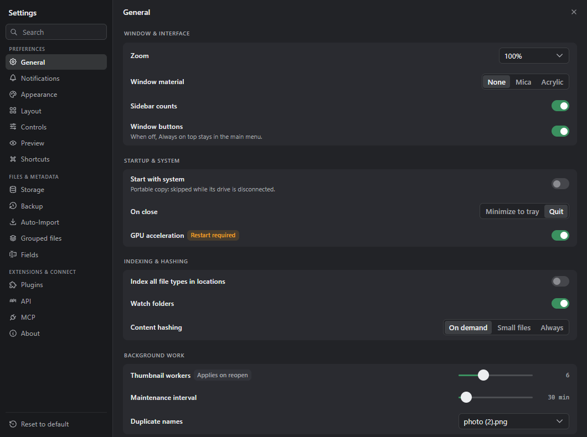

# Settings

Open **Settings** with ++ctrl+comma++ or from the **Main menu**. Settings opens in a searchable window with pages grouped under **Preferences**, **Files & metadata** and **Extensions & connect**.

<figure class="curio-shot" markdown>

<figcaption>Curio's searchable Settings window with application-level and per-library pages.</figcaption>
</figure>

## Pages

| Page | Scope | What you configure here |
|---|---|---|
| **General** | Application *(and Per library)* | Language, zoom, Windows 11 window material, startup, close behavior, GPU acceleration and this library's indexing, hashing and background workers. |
| **Notifications** | Application | Sound effects toggle, per-event sound checkboxes, **Test sound** button and **Import notifications** timing (*Always*, *In background*, *Failures only* or *Off*). |
| **Appearance** | Application | Dark and Light theme slots, **Follow system**, built-in and custom themes, interface font, corners, spacing, scrollbars and **Custom CSS**. |
| **Layout** | Application *(or Per library)* | Landscape and Portrait layout presets, Library and Inspector dock positions, compact rail behavior, edge-hover reveal and **Per-library layout**. |
| **Controls** | Application | **Viewer controls** (mouse wheel, **Space** mode, right-click drag to zoom) and **Grid & mouse actions** (double-click, middle-click, side buttons, animated images). |
| **Preview** | Application | **Image viewer** (strip, upscaling, default zoom, rotation, transparency, remember zoom), **Video & audio playback** and **Web links** (**Link previews**). |
| **Shortcuts** | Application | Search, record, clear and reset app, viewer, user action and plugin keyboard shortcuts with conflict detection. |
| **Storage** | Per library | Indexed **Locations**, library paths and IDs, thumbnail cache location and limit, stray or pending **Files** and Eagle `.library` import. |
| **Backup** | Per library | Manual and scheduled **Database backups**, restore list, retention count, backup folder and **Maintenance** (**Check integrity** and **Optimize**). |
| **Auto-Import** | Per library | Auto-import toggle, watched folders with per-folder options, per-computer approval and ordered import rules. |
| **Grouped files** | Per library | **RAW + JPEG** display mode, built-in and plugin companion grouping rules, **Check**, **Group existing** and **Split all**. |
| **Fields** | Per library | User-defined **Custom** fields, built-in and plugin metadata fields, indexing toggles, filter kinds, failure inspection, rescans and **Clean up**. |
| **Plugins** | Per library *(tools: App)* | Built-in and external plugins across **Formats**, **Widgets** and **Windows**, permissions, rescans and external CLI tool paths under **Tools**. |
| **API** | Application | Local loopback API toggle, endpoint URL, port (default `41733`), **Open from the browser** handler and scoped API tokens. |
| **MCP** | Application | Built-in Streamable HTTP MCP server (`POST /mcp`), endpoint URL and per-family toggles for exposed MCP tools. |
| **About** | Application | Curio version, portable status, copyable settings folder path, built-with stack and credits. |

## Search & reset

- **Full-settings search**: Type in the search box at the top of Settings to filter across every page at once. Matching sections stay visible with matched words highlighted, and the left rail shows hit counts per page.
- **Reset to default**: Click **Reset to default** at the bottom of the left rail to restore stock preferences, layouts and shortcuts. Libraries, custom themes, API settings, tokens and startup options stay untouched.

## Scopes

| Scope | Where stored | Examples |
|---|---|---|
| **Application (this computer)** | `%APPDATA%\Curio` (Windows), `~/.config/Curio` (Linux), `~/Library/Application Support/Curio` (macOS) or `Curio data/` (portable) | General (window and startup), Notifications, Appearance, Controls, Preview, Shortcuts, API, MCP, CLI tool paths, recent libraries and computer-level plugin settings. |
| **Library (travels with `.curio`)** | Inside `<Library>.curio/library.db` (plus optional `layout.json`) | General (indexing, hashing and background work), Storage, Backup, Auto-Import (paused until approved on another computer), Grouped files, Fields, per-library Plugins and **Per-library layout**. |
| **Window (session)** | Per open window | Current folder or scope, search text, unlocked filters, filmstrip visibility, window geometry and always-on-top state. |

When you have multiple libraries, **Storage**, **Backup** and **Auto-Import** show a library switcher in the Settings header so you can inspect or configure another library directly.
