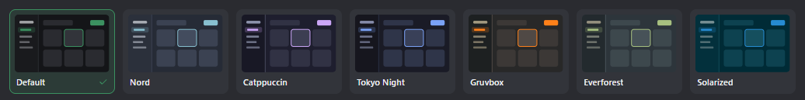

# Appearance

CSS custom properties (**design tokens**) control every color, corner radius, spacing unit and font across Curio's interface and opt-in plugin pages.

## Themes

<figure class="curio-shot" markdown>

<figcaption>Curio's seven built-in theme families in Settings › Appearance, each with Dark and Light palettes.</figcaption>
</figure>

Open **Settings › Appearance** to manage themes:

- **Dark and Light slots**: Curio keeps separate theme choices for **Dark** and **Light** modes.
- **Follow system**: Turn on **Follow system** to switch between your Dark and Light themes automatically with Windows, Linux or macOS. Turn it off to pin whichever tab is selected.
- **Built-in families**: Seven theme families ship with both Dark and Light palettes (14 themes total): **Default**, **Nord**, **Catppuccin** (Mocha and Latte), **Tokyo Night** (Night and Day), **Gruvbox**, **Everforest** and **Solarized**. Each card previews its surface, sidebar, accent and star colors.
- **Custom themes**: Click **Duplicate theme** to copy the active theme and customize its accent or palette.

## Interface & density

Adjust layout proportions under **Settings › Appearance › Interface & density**:

- **Font**: Pick any installed system typeface or keep **System font**.
- **Corners & spacing**: Choose corner roundness (**None**, **Small** or **Rounded**) and spacing density (**Compact**, **Normal** or **Expanded**).
- **Scrollbars**: Choose **Overlay** scrollbars (hidden until scrolling, taking no layout width) or **Beside content** scrollbars.

## Window material

Configure scaling and backdrop effects under **Settings › General › Window & interface**:

- **Zoom**: Scale the entire interface from `60%` to `200%`.
- **Windows 11 translucent materials**: On Windows 11 (22H2 and later), **Window material** adds two translucent backdrops:
  - **Mica**: Tints the window backdrop from your desktop wallpaper.
  - **Acrylic**: Blurs windows behind Curio with configurable **Transparency** (*Low*, *Medium* or *High*).
  - Interface surfaces use translucent tints over Mica and Acrylic. When the window loses focus, Curio falls back to solid theme colors unless **Keep when inactive** is on.

## Theme files

- **Live editor**: Click **Duplicate theme** (or **Edit `<name>`** on a custom theme) to edit all 15 color tokens with color pickers, hex inputs and live preview.
- **Import & export**: Use **Export current theme** or **Import theme** in the **Color theme** header to save or load a plain `.css` theme file:

```css
/* Curio theme: Midnight */
:root {
  --bg: #15171c;
  --panel: #1b1e24;
  --text: #e8eaee;
  --accent: #3b9160;
  /* Omitted tokens are derived automatically from the base theme */
}
```

- **Follow a `.css` file**: Choose a local CSS file under **Settings › Appearance › Custom CSS › Follow a .css file**. Curio reloads it whenever the window regains focus, which works well with wallpaper theming tools such as `pywal`, `matugen` and `wallust`.

## Custom CSS

Fifteen primary tokens define a Curio theme. Curio derives all secondary hover, selection, border and status tokens automatically. Export the active theme or open the theme editor to inspect the full token set.

| Token | Role |
|---|---|
| `--bg` | Main window background behind the asset grid |
| `--panel` | Library sidebar and Inspector backdrop |
| `--surface`, `--surface-2`, `--surface-3` | Floating menus and dialogs, raised cards and elevated headers |
| `--border` | Separators and structural borders |
| `--text`, `--text-muted`, `--text-faint` | Primary, secondary and hint text |
| `--accent` | Primary accent color, selection highlight and focus rings |
| `--info`, `--success`, `--warning`, `--danger`, `--star` | Status colors and rating stars |

Plugins can declare scoped variables (`--plugin-<name>`) in `plugin.json`. For targeted overrides beyond tokens, paste rules into **Settings › Appearance › Custom CSS › User CSS**. Token names stay stable across releases, while internal class names may change.

## Safe mode

If custom CSS or a broken theme makes the window unreadable, launch Curio once with `--safe-mode`:

```powershell
# Windows
Curio.exe --safe-mode
```

```bash
# Linux
curio --safe-mode

# macOS
/Applications/Curio.app/Contents/MacOS/curio --safe-mode
```

Safe mode ignores custom themes, **User CSS**, followed CSS files and plugin theme variables. Open **Settings › Appearance** to repair or reset your theme. See [Launch flags](../../start/install.md#launch-flags) for all command-line options.
