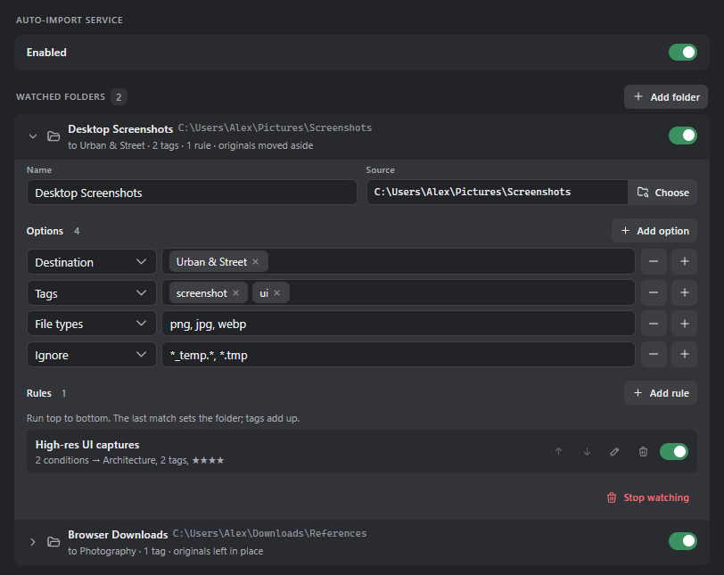

# Auto-Import

**Auto-Import** (**Settings › Auto-Import**) watches disk folders you choose and copies new files into the active library. It files, tags, rates and annotates each asset according to your folder options and ordered rules. Auto-Import settings are stored **per library**.

<figure class="curio-shot" markdown>

<figcaption>Auto-Import configured with a watched screenshots folder, destination and file-type options, and an ordered filing rule.</figcaption>
</figure>

## Watched folders

1. Open **Settings › Auto-Import** and turn on **Auto-import service**.
2. Click **Add folder** and choose the directory on disk.
3. Give the folder a **Name** and add any **Options** you want to override (**Destination**, **Tags**, **Subfolders**, **Originals**, **File types** or **Ignore**).
4. Add optional **Rules**, then switch the watched folder on. Changes save automatically.

By default, a watched folder uses no destination folder, flattens subfolders, accepts all supported file types and moves imported originals to `.imported`.

!!! note "Folders that cannot be watched"
    For safety, Curio refuses to watch whole drives, your user home folder (or any parent folder containing it), OS system directories, the current `.curio` library folder or any other `.curio` library folder.

## Subfolder modes

Choose how each watched folder handles files inside subdirectories:

| Subfolder mode | Behavior |
|---|---|
| **Ignore** | Imports only files directly inside the top level of the watched folder and skips subdirectories. |
| **Flatten** | Scans all subdirectories and imports every matching file into one destination folder. |
| **Mirror as folders** | Recreates the subdirectory tree as Curio folders under the chosen destination folder, reusing existing folders of the same name. |
| **Existing folders only** | Imports only files whose top-level subdirectory name already matches a folder in the library; files in unmatched subdirectories stay untouched on disk. |

## Filters & ignores

- **File types**: Optional comma-separated list of extensions (for example `png, jpg, webp, mp4`). Leave blank to accept every supported file type.
- **Ignore**: Glob patterns for files or paths to skip (for example `*.txt, temp_*, raw/**`). Empty files, partial browser downloads, temporary or system files, shortcuts, hidden folders, `.imported` and other `.curio` libraries are always ignored.
- **Grouped companions**: When a file arrives with grouped companions (such as a Live Photo `.mov`, `.aae` edits, `.xmp` sidecar or AI model preview), Curio imports them together as one grouped asset. This happens even if **File types** lists only the primary extension. Companions follow the same after-import action as their primary file. A companion still being written holds back the whole asset until settled, and a lone sidecar without its primary file stays untouched.

## Rules

Each watched folder can hold an ordered list of **Rules** evaluated top to bottom against each discovered file. Click **Add rule** or click an existing rule row to open the rule editor, and use the up and down buttons to reorder rules.

When a file arrives, Curio resolves its destination and metadata in three steps:

1. Start with the watched folder's default **Destination** and **Tags** (or unfiled and untagged if none are set).
2. Run matching rules from top to bottom. A later rule's **Move to folder** replaces an earlier folder, while **Add tags** combines tags across all matching rules. **Skip file** cancels import of that file, and **Stop after this rule** halts later rules.
3. If **Subfolders** is set to **Mirror as folders**, create the mirrored subdirectory tree underneath whichever destination folder step 2 selected.

Each rule matches either **all** or **any** of its conditions:

| Condition field | Supported operators | Notes |
|---|---|---|
| **Base name**, **File name**, **Extension**, **Subfolder path**, **Full path** | `contains`, `does not contain`, `is`, `is not`, `starts with`, `ends with`, `matches regex`, `does not match regex` | Case-insensitive text matching. Regex accepts a bare pattern (case-insensitive) or `/pattern/flags`; invalid regexes never match. *Subfolder path is* empty matches files directly in the watched root. |
| **File size**, **Width (px)**, **Height (px)**, **Age (days)** | `>`, `≥`, `<`, `≤`, `=` | File size accepts bytes or units (`50KB`, `2.5MB`, `1GB`). |

A condition with an empty value is ignored (except *Subfolder path is* empty), and a rule with no complete condition never matches.

## Rule actions

In the rule editor, check **Skip file** or add any combination of actions:

- **Move to folder**: Overrides the watched folder's default **Destination** or an earlier matching rule.
- **Add tags**: Appends tags to the watched folder's defaults and earlier matching rules.
- **Set rating**: Assigns a `0`–`5` star rating.
- **Set note**: Sets annotation text on the imported asset.

## Originals

Choose what happens to the source file on disk after Curio copies it into managed storage:

| After importing | Behavior |
|---|---|
| **Move to `.imported`** | Moves originals into a `.imported` subdirectory beside the watched folder while keeping their relative subfolder structure. |
| **Move to Recycle Bin** | Sends the original to the OS Recycle Bin or Trash only after verifying the original did not change and the library copy matches byte for byte. |
| **Leave in place** | Keeps the original file untouched on disk. Curio remembers each imported version so it is not re-imported unless modified. |

## Settling & approval

- **3-second settle delay**: A file must stay unchanged for at least `3` seconds before Curio imports it (and unlocked on Windows). This prevents half-written downloads or exports from importing too early.
- **Polling budget**: Curio checks watched folders every `4` seconds and throttles scans on large trees so they stay within `5%` of elapsed wall time. Auto-Import runs only while the library is open in a window or background holder.

!!! note "Per-computer approval"
    Auto-Import watches live inside the `.curio` library database, so moving a library to another computer could otherwise trigger unexpected disk moves on the new machine. Watches created on this computer run immediately, while watches brought from another computer start paused with an **Allow** button until you approve them. Changing a watch's folder path, subfolder mode, file types, ignore patterns or after-import action requires approval on this computer again.
