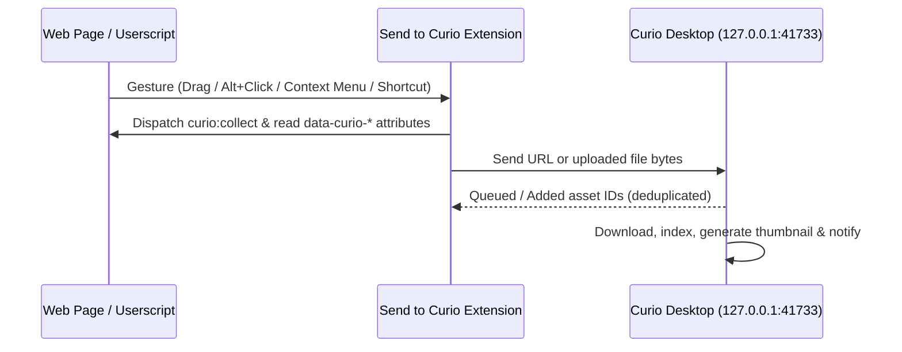

# Browser

[**Send to Curio**](https://github.com/Erehr/curio-extension) is Curio's browser extension for Chrome, Edge and Chromium-based browsers. Two userscripts (`send-to-curio.user.js` and `curio-attributes.user.js`) also support Tampermonkey and Violentmonkey. Both talk locally to Curio's [Web API](../../api/connect/http.md) over `127.0.0.1` with no cloud relay.



## Install & pair

1. Download the release package from [**Erehr/curio-extension**](https://github.com/Erehr/curio-extension/releases) (or clone the repository) and extract it.
2. Open `chrome://extensions` (or `edge://extensions`) and turn on **Developer mode**.
3. Click **Load unpacked** and select the extracted extension folder. The unpacked manifest uses a fixed extension ID so paired tokens stay valid across reinstalls.
4. Start Curio and enable the API in **Settings › API** (default port `41733`).
5. Open the extension's **Options** from the toolbar icon menu, verify the port and click **Connect**.
6. In Curio's pairing dialog, check that the verification code and browser name match the extension.
7. Choose whether to allow all libraries or specific ones, then click **Allow**.

Curio generates a token pinned to the extension's origin with `library.read`, `metadata.read`, `metadata.write`, `organize` and `files.write`. Inspect, rename, narrow or revoke it anytime in **Settings › API**. For manual setup, click **Other ways** in Extension Options and paste a token from **Settings › API**.

## Destinations

When the capture panel opens (in-page card, browser side panel or popup window):

- **Library selector**: Pick any library on your Curio list, whether open in a window, running in the background or closed (Curio opens closed libraries in the background automatically). Each library remembers its last-selected folders and tags.
- **Folders**: Filter the folder tree by typing, pick from **Recently used** at the top or choose **All** to file without a folder. Select multiple folders if needed (the first becomes the primary managed directory on disk). Typing a new folder name offers **Create** when the token has `organize`.
- **Tags**: Uses Curio's tag picker grouping (**Starred**, **Recently used**, **Recommended** words from the title or filename, and tag groups). Click the pin icon to keep chosen tags across later saves.
- **Presets**: Save frequent library, folder and tag combinations under a named **Preset** in the panel footer for one-click recall.
- **Custom choice fields**: User-defined single-choice and multiple-choice fields appear in the panel automatically. Plugin-owned fields remain managed by their plugins.
- **Theme**: Follows Curio's default light or dark theme automatically. Enable **Use Curio's theme** in **Options › Panel** to match your active Curio theme.

## Capture modes

Send to Curio provides five capture gestures that you can mix or toggle in **Options**:

| Gesture | Behavior |
|---|---|
| **Right-click › Save to Curio** | Opens the capture panel prefilled with the picture, video, audio, file or link under the pointer. |
| ++alt++ + click | Saves the clicked image, video, audio or link directly to your destination without opening the panel (enabled by default; the page never sees the click). |
| **Drag card** (*Mode: Drag*, default) | Pull an image or link slightly to reveal a floating drop card with a drop zone and your last library's folders. Drop onto a folder to save immediately, or onto the drop zone to open the full panel. Native draggable page UI (`draggable="true"`) stays untouched. |
| **Hover button** (*Mode: Button*) | Shows a small button in a configurable corner of images and videos above your minimum pixel size (default 48 px). Click it to open the panel. |
| **Toolbar button** | Opens a menu with **Open** (empty drop/paste panel), **Save page as link**, **Screenshot area**, **Screenshot**, **Mode** (*Drag* / *Button* / *None*), **Position** (*Card* / *Side panel*) and **Options**. |

Send to Curio inspects what sits directly under the pointer. It detects images under transparent overlays, inside shadow DOM or iframes, the largest candidate in `srcset` or `<picture>`, CSS background images, inline SVGs, `<canvas>` elements and `blob:` images.

## Side panel

- **Side panel mode**: Set **Position** to **Side panel** (or toggle **Use side panel** in **Options › Panel**) to dock the capture form in Chrome or Edge's native side panel. Enable **Folders between saves** to show your library folders and drop zone while the form is idle.
- **Default browser shortcuts** (customizable on Chrome or Edge's extension shortcuts page):

| Default shortcut | Action |
|---|---|
| ++alt+shift+s++ | Save the asset under the pointer directly without opening the panel |
| ++alt+shift+c++ | Open the toolbar button menu |
| ++alt+shift+a++ | Screenshot a dragged area of the page (++escape++ cancels) |
| ++alt+shift+l++ | Save the current page as a web link |
| *(Unbound by default)* | Screenshot the visible tab area; save page link directly to All |

- Inside the panel, press ++ctrl+enter++ to send or ++escape++ to close.

## Links & screenshots

- **Save page as link**: Saves a `.url` bookmark and attaches a screenshot of the current tab as its thumbnail so logged-in or dynamically rendered pages show an exact preview. Uncheck **Save as link** in the form to save the screenshot itself as a PNG instead.
- **Screenshot / Screenshot area**: Captures a lossless PNG of the visible viewport or a dragged selection at your display's native pixel density. The file is named after the page title with the page URL saved as its source address.

## Site rules

### Full-res upgrades

For sites that serve downscaled thumbnails, Send to Curio tries the full-resolution URL first and falls back to the displayed image if the host declines:

- Next.js & Vercel image optimizers (`/_next/image`)
- `images.weserv.nl` proxies
- Wikimedia Commons picture thumbnails
- X / Twitter (`name=orig`)
- Pinterest (`originals`)
- Reddit preview images

### Custom rules

Configure ordered rules in **Options › Site rules**. Rules run top to bottom and match **All** or **Any** conditions:

- **Conditions**: **Site** (host or subdomain match, comma-separated), **Page URL**, **Page title**, **File URL**, **Extension** (text match or `/regex/flags`), **Type** (*Image*, *Video*, *Audio*, *File*, *Link*, *Page*) and **Width** / **Height** in pixels.
- **Actions**: Set **Library** and **Folders**, append **Tags**, extract up to 30 tags from the page using a **Tag selector** (CSS selector), enable **Use page destination** (trusting `data-curio-library` and `data-curio-folders`), force **Open panel** or **Stop processing rules**.

### Page metadata

Web pages and userscripts can provide exact high-res URLs, titles, notes, tags, ratings, custom fields and suggested destinations through `data-curio-*` attributes (and Eagle's `eagle-*` aliases, enabled by default). See [Web page and userscript capture contract](../../api/connect/browser-markup.md).

## Downloads & auth

- **Direct Curio downloads (default)**: Public `http` and `https` URLs go to Curio's persistent download queue with the page's `Referer` and browser `User-Agent`.
- **Signed-in sites**: Enable **Send the site's cookies with a download** in **Options › Downloads** to attach the browser's cookies (including partitioned cookies) for that request only. Neither the extension nor Curio stores cookies. Alternatively, enable **Download through the browser** so the browser fetches the file with its active session and uploads the bytes to Curio (up to 44 MB inline, or up to 2 GB via file upload).
- **Page-only assets**: Screenshots, `blob:` URLs, `<canvas>`, inline `<svg>` and local or LAN addresses are always read by the browser and uploaded as bytes.
- **Streams (`.m3u8`, `.mpd`, MediaSource `blob:` videos)**: Streaming playlists have no single downloadable file, so Send to Curio saves the page as a link. A plugin URL handler (such as a `yt-dlp` downloader) can then handle it.

## Queue & background

- **Offline queue**: If Curio is closed when you capture something, Send to Curio stores URLs (and immediately fetched bytes for screenshots and blobs) in browser IndexedDB up to 500 MB across browser restarts. Manage waiting captures under **Options › Queue**.
- **Open Curio in background**: Clicking **Open Curio** in the extension triggers `curio://open?background=1` and launches Curio into the system tray or menu bar so queued saves drain in the background. Disable browser launch links under **Settings › API › Open from the browser**.
- **Safe retries**: Every save is deduplicated so retrying after an unexpected close does not create duplicate assets.
- **Disconnect**: Click **Disconnect** in Extension Options to revoke the token in Curio and clear the token and cached library metadata from the browser.

## Userscript

If you use **Violentmonkey** or **Tampermonkey** (for example in Firefox or without installing the browser extension), two GPL-3.0 userscripts ship with this documentation:

- [**`send-to-curio.user.js`**](../../assets/userscripts/send-to-curio.user.js): Adds a **Curio** hover button on images (≥ 120 px) that fetches signed-in pictures through the browser (`GM_xmlhttpRequest`) or sends public URLs to Curio via `http://127.0.0.1:41733/api/v1/curio.js`. Menu commands set your token, switch target libraries or save the current page as a link.
- [**`curio-attributes.user.js`**](../../assets/userscripts/curio-attributes.user.js): Reference template showing how to set `data-curio-*` attributes and respond to `curio:collect` for Send to Curio. See [Browser markup](../../api/connect/browser-markup.md#example-userscript).

**Setup for `send-to-curio.user.js`**:

1. Start Curio and enable the API in **Settings › API** (default port `41733`).
2. Create an API token in **Settings › API** with `library.read` and `files.write`.
3. Install [**`send-to-curio.user.js`**](../../assets/userscripts/send-to-curio.user.js) (or copy the script below into Violentmonkey or Tampermonkey) while Curio is running so your userscript manager fetches `curio.js`.
4. Open the userscript menu to enter your token and pick an optional target library.

??? example "send-to-curio.user.js"

    ```javascript
    // ==UserScript==
    // @name         Send to Curio
    // @namespace    curio
    // @version      1.1.0
    // @description  A Curio button on pictures: one click sends the picture, with the page it was on, to a Curio library. The script's menu sends the page as a link.
    // @match        *://*/*
    // @require      http://127.0.0.1:41733/api/v1/curio.js
    // @grant        GM_xmlhttpRequest
    // @grant        GM_getValue
    // @grant        GM_setValue
    // @grant        GM_registerMenuCommand
    // @connect      127.0.0.1
    // @connect      *
    // @noframes
    // ==/UserScript==

    /* global Curio */
    ;(function () {
      'use strict'

      const MIN_SIZE = 120
      const HIDE_MS = 400
      let curio = null
      let button = null
      let target = null
      let hideTimer = null

      function client() {
        const token = GM_getValue('token', '')
        if (!token) return null
        if (!curio) curio = Curio.connect({ token, port: GM_getValue('port', 41733), library: GM_getValue('library', '') || undefined })
        return curio
      }

      function toast(text, error = false) {
        const t = document.createElement('div')
        t.textContent = text
        t.style.cssText = `position:fixed;z-index:2147483647;right:16px;bottom:16px;max-width:360px;padding:9px 14px;border-radius:8px;font:13px/1.4 system-ui,sans-serif;color:#fff;background:${error ? '#b33a3a' : '#0e7c8f'};box-shadow:0 4px 16px rgba(0,0,0,.3)`
        document.documentElement.append(t)
        setTimeout(() => t.remove(), error ? 6000 : 2500)
      }

      function askToken() {
        const token = prompt('A token from Curio, Settings › API, with library.read and files.write:', GM_getValue('token', ''))
        if (token === null) return false
        GM_setValue('token', token.trim())
        curio = null
        return !!token.trim()
      }

      async function chooseLibrary() {
        const c = client() || (askToken() && client())
        if (!c) return
        try {
          const list = (await c.library.list()).filter((l) => l.state !== 'offline')
          const lines = list.map((l, i) => `${i + 1}. ${l.name}${l.default ? ' (default)' : ''}`).join('\n')
          const n = prompt(`Library to send to (empty for default):\n\n${lines}`, '')
          if (n === null) return
          const pick = list[Number(n) - 1]
          GM_setValue('library', pick ? pick.id || pick.name : '')
          curio = null
          toast(pick ? `Sending to ${pick.name}` : 'Sending to the default library')
        } catch (e) {
          toast(e.message, true)
        }
      }

      // the picture as this browser sees it, with the site's sign-ins and from addresses Curio won't download from
      function fetchBytes(url) {
        return new Promise((resolve) => {
          GM_xmlhttpRequest({
            method: 'GET', url, responseType: 'blob',
            onload: (r) => resolve(r.status >= 200 && r.status < 300 && r.response && r.response.size ? r.response : null),
            onerror: () => resolve(null),
            ontimeout: () => resolve(null),
          })
        })
      }

      function dataUrl(blob) {
        return new Promise((resolve, reject) => {
          const r = new FileReader()
          r.onload = () => resolve(r.result)
          r.onerror = () => reject(r.error)
          r.readAsDataURL(blob)
        })
      }

      function fileName(url, type) {
        let base = 'picture'
        try {
          base = decodeURIComponent(new URL(url).pathname.split('/').filter(Boolean).pop() || base)
        } catch (_) {}
        const ext = (type.split('/')[1] || '').replace('jpeg', 'jpg').replace('svg+xml', 'svg')
        return /\.[a-z0-9]{2,5}$/i.test(base) || !ext ? base : `${base}.${ext}`
      }

      async function send(what) {
        const c = client() || (askToken() && client())
        if (!c) return
        try {
          const blob = what.image ? await fetchBytes(what.image) : null
          // the page says where a picture was found
          const r = blob
            ? await c.item.add.fromBytes({ data: await dataUrl(blob), name: fileName(what.image, blob.type || ''), url: what.page })
            : what.image
              ? await c.item.add.fromUrls({ urls: [what.image], sourceUrl: what.page, referer: what.page, wait: false })
              : await c.item.add.bookmark({ url: what.page, name: document.title || undefined })
          if (r.errors && r.errors.length) throw new Error(r.errors.join('; '))
          // a download is Curio's to tell, in a notification of its own
          toast(r.queued ? 'Sent to Curio' : what.image ? 'Picture sent to Curio' : 'Page sent to Curio')
        } catch (e) {
          if (e.code === 'unauthorized' && askToken()) return send(what)
          toast(e.message, true)
        }
      }

      function place() {
        const r = target.getBoundingClientRect()
        button.style.top = Math.max(4, r.top + 6) + 'px'
        button.style.left = Math.max(4, r.right - button.offsetWidth - 6) + 'px'
      }

      function show(img) {
        clearTimeout(hideTimer)
        target = img
        if (!button) {
          button = document.createElement('button')
          button.textContent = 'Curio'
          button.title = 'Send this picture to Curio'
          button.style.cssText = 'position:fixed;z-index:2147483647;padding:4px 10px;border:0;border-radius:6px;font:600 12px/1.4 system-ui,sans-serif;color:#fff;background:#0e9fb5;box-shadow:0 2px 8px rgba(0,0,0,.35);cursor:pointer'
          button.addEventListener('mouseenter', () => clearTimeout(hideTimer))
          button.addEventListener('mouseleave', hide)
          button.addEventListener('click', (e) => {
            e.preventDefault()
            e.stopPropagation()
            const src = target && (target.currentSrc || target.src)
            if (src) send({ image: new URL(src, location.href).href, page: location.href })
          })
          document.documentElement.append(button)
        }
        button.hidden = false
        place()
      }

      function hide() {
        clearTimeout(hideTimer)
        hideTimer = setTimeout(() => button && (button.hidden = true), HIDE_MS)
      }

      document.addEventListener('mouseover', (e) => {
        const img = e.target.closest && e.target.closest('img')
        if (img && img.naturalWidth >= MIN_SIZE && img.naturalHeight >= MIN_SIZE && !img.src.startsWith('data:')) show(img)
      }, true)
      document.addEventListener('mouseout', (e) => {
        if (e.target === target) hide()
      }, true)
      window.addEventListener('scroll', () => button && !button.hidden && target && place(), { passive: true })

      GM_registerMenuCommand('Send page to Curio as link', () => send({ page: location.href }))
      GM_registerMenuCommand('Choose the library', chooseLibrary)
      GM_registerMenuCommand('Set the token', askToken)
    })()
    ```
