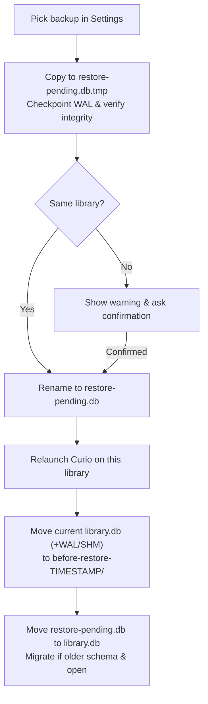

# Backup

Curio includes built-in database backups, integrity checks and guided restoration under **Settings › Backup**. Backups run while your library is open and are verified before completion.

## What is backed up

Each backup is a timestamped folder (for example `20261124-143015/`) containing three files:

| File | Contents |
|---|---|
| `library.db` | A consistent online SQLite snapshot created with `VACUUM INTO` and checked with `PRAGMA quick_check` before completion |
| `metadata.json` | A portable JSON export of every top-level asset's metadata (names, folders, tags, ratings, notes, source URLs and custom fields) |
| `manifest.json` | Format identifier (`curio-backup/1`), creation timestamp, schema version, Curio version, library and installation identifiers, backup kind (`manual` or `scheduled`), byte size and BLAKE3 hash of `library.db` |

Backups are built inside a `<timestamp>.tmp` folder, verified and atomically renamed to `<timestamp>` only after all checks pass. Any folder without `.tmp` that contains a valid `manifest.json` is complete.

Curio also creates an automatic **pre-migration backup** (`backups/pre-migration-v<old>-<timestamp>/library.db`) whenever a newer Curio version upgrades your database schema. If creating or checking that backup fails, the upgrade aborts and leaves your database untouched.

## Originals & plugins

!!! warning "Database backups do not copy your asset files"
    Curio's built-in backups protect your **index and organization** (`library.db` and `metadata.json`). They do **not** copy your media files, external locations, thumbnails or standalone plugin folders.

To protect your full collection against drive failure, include these folders in your regular system backup tool (such as Windows File History, Time Machine, Borg, Restic or rsync):

| Data | Where it lives | Included in Curio DB backup? |
|---|---|---|
| Folders, tags, smart folders, ratings, notes, custom fields, library settings | `<library>.curio/library.db` | Yes |
| Copied original files | `<library>.curio/files/` | No; back up separately |
| Indexed external files | Each folder listed in **Locations** | No; back up separately |
| Custom actions & per-library layouts | `<library>.curio/actions.json`, `layout.json` | No; back up with `.curio` folder |
| Library-local plugins | `<library>.curio/plugins/` | No; back up with `.curio` folder |
| Global app settings, themes, API tokens, installed plugins | Curio settings and data folders (or `Curio data/` in portable mode) | No; back up separately |
| Thumbnails & previews | `<library>.curio/cache/` | No (regenerable; safe to exclude) |

## Schedule

Configure automatic backups per library under **Settings › Backup › Database backups**:

- **Back up automatically**: Choose **By hand only** (`0`), **Daily** (`24` hours, default) or **Weekly** (`168` hours). Automatic backups run only when the library has changed since the last backup and wait until startup reconciliation finishes. If a scheduled backup fails, Curio shows the error in Settings and retries after an hour.
- **Keep backups**: Drag the slider to keep `1` to `50` verified backups of this library (default `10`), or set it to `0` (**All**). Pruning removes only verified backups belonging to this library. Backups from other libraries, pre-migration copies and folders without a manifest are never deleted automatically. Unfinished `.tmp` folders older than `1` hour are cleaned up automatically.
- **Backup folder**: By default, backups go into `<library>.curio/backups/`. Click **Change** to pick a folder on another drive so a single drive failure does not destroy both your library and its backups. With a custom destination, Curio creates a subfolder named after `<library>.curio` so multiple libraries can share one backup folder. Click **Default location** to return to `<library>.curio/backups/`.

The panel shows the timestamp of the last successful backup, or the error message and time if the last attempt failed.

## Manual backup

Manual snapshot and maintenance actions live under **Settings › Backup**:

- **Back up now** (**Database backups**): Runs a verified manual backup in the background and notifies you when done.
- **Check integrity** (**Maintenance**): Runs a full SQLite `PRAGMA integrity_check` on the live library database using a pooled read connection so the window stays responsive. Curio also runs `PRAGMA quick_check` every time a library opens and offers to open **Settings › Backup** if it finds problems.
- **Optimize** (**Maintenance**): Runs SQLite `PRAGMA optimize`, merges full-text search segments, truncates the WAL file, enforces the thumbnail cache limit, cleans stale temporary files and checks for stray files in `files/`. Curio also runs this automatically on a timer configured under **Settings › General › Background work › Maintenance interval** (default `30` minutes).

## Restore

Click **Restore a backup** under **Settings › Backup › Database backups** to list restorable databases sorted newest first. The list scans your configured backup folder, `<library>.curio/backups/` and `<library>.curio/` (including `pre-migration` and `before-restore` copies). Each row shows the timestamp, kind (**By hand**, **Automatic**, **Before an upgrade**, **Set aside by a restore** or **Older backup**), schema version and size. Verified backups show a checkmark when their manifest matches their file size, and backups from a different library show an **other library** badge.

Click **Choose file** at the bottom of the list to pick any `.db` file from disk.

Clicking **Restore** asks for confirmation, stages the backup and restarts Curio on that library to swap the database while no connections are open.

!!! note "Unfinished file operations from before a restore are set aside"
    When a library opens after a restore, pending file operations recorded in that backup are set aside instead of run. Files on disk may have changed since the backup was taken. Inspect them under **Settings › Storage › Files**.

## Compatibility

Before staging or applying a restore, Curio validates the selected file without modifying the live database:

- **Valid SQLite and Curio schema**: The file must be a valid SQLite 3 database passing `PRAGMA quick_check`, with schema version `>= 1` and an `assets` table. If a picked file has a `-wal` file beside it, Curio copies the WAL alongside the temporary copy and checkpoints it first so recent writes are not lost.
- **Older schema versions**: Restoring a backup from an older Curio version is supported. When Curio reopens the restored database, it creates a pre-migration backup and runs forward migrations up to the current schema.
- **Newer schema versions**: A backup created by a newer Curio version whose schema exceeds what the installed build understands is refused with an error so newer data is never corrupted.
- **Safety copy before replacement**: Before placing the restored database at `library.db`, Curio moves your current `library.db` (with its `-wal` and `-shm` files) into `<library>.curio/before-restore-<timestamp>/`. If the swap fails, Curio rolls those files back into place. That `before-restore` folder also appears in **Restore a backup** so you can undo a restore.

## Related

- [Copied files and indexed locations](storage.md): Library folder layout and `files/` management.
- [Export files and metadata](../import/export.md): Exporting JSON, CSV and sidecars vs. backing up a database.
- [Recover files and library data](../help/storage.md): Troubleshooting damaged databases and rejected restores.
