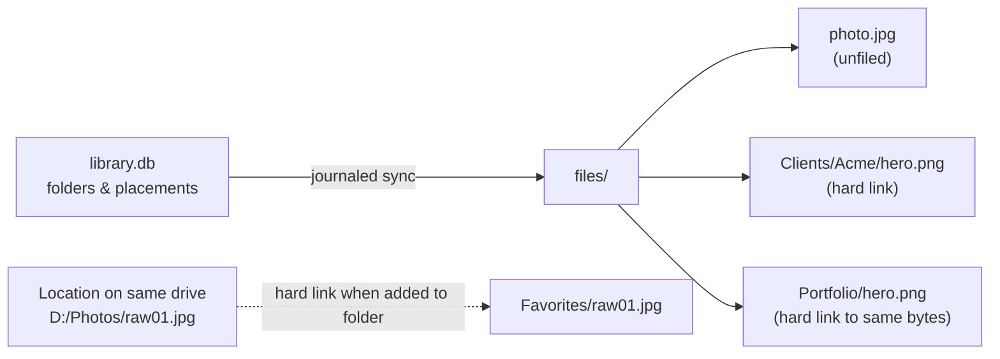

# Storage

A single Curio library can hold assets in two ways side by side: **copied into the library** (managed storage) and **linked in place** (indexed locations). Both appear together in search results, folders, tags, smart folders and views.

## Library structure

Every library is an ordinary folder on disk named `<name>.curio`. Originals, caches, backups and the database live in separate subfolders:

```text
My Library.curio/
├── library.db           SQLite database (index, folders, tags, fields, settings)
├── actions.json         Library-scoped custom actions
├── layout.json          Per-library layouts and view state (when per-library layout is enabled)
├── files/               Managed store mirroring your library folders and files
│   └── .trash/          Hidden folder holding trashed managed files and links
├── cache/
│   ├── thumbs/          Generated thumbnails
│   ├── previews/        Derived preview cache
│   └── tmp/             Short-lived temporary files
├── backups/             Automatic, manual and pre-migration database backups
├── exports/             Default folder for library exports
└── plugins/             Optional library-local plugins
```

Move the thumbnail cache to another drive under **Settings › Storage › Library & thumbnail cache**, where you can also set a size limit from `256 MB` to `65536 MB` (default `4096 MB`). Everything else stays inside `<name>.curio`.

## Storage modes

| Aspect | Linked in place (Location) | Copied into the library (`files/`) |
|---|---|---|
| Where the original lives | Where it already is on disk, inside an added location | Inside `<library>.curio/files/` |
| How assets are added | **Add location**, **Add Eagle library as location** or linking individual files | **Import folder**, **Import files**, drops and pastes, saved web links, **Auto-Import**, **Import Eagle library** |
| Library folders | Original stays in its location; each library folder it joins gets a hard link in `files/` (or a copy across drives) | Real directories under `files/` mirroring the library folder tree |
| Renaming an asset | Changes only the display name in Curio, unless the location is set to **Edit and organize** | Renames the file on disk while keeping its extension |
| Asset in multiple folders | One asset record; a link in each folder under `files/` | One copy of the bytes on disk; a hard link in each folder under `files/` |
| Independent copy (++ctrl++ + drag onto a folder, or **Duplicate**) | Creates a new managed asset with its own bytes | Creates a new managed asset with its own bytes |
| Trash and purge | Original stays untouched on disk; emptying Trash removes only store links and forgets the asset | Deleting moves the folder's link to `files/.trash/`; emptying Trash sends managed files to the OS Recycle Bin or Trash |

Switch individual assets or whole locations between the two modes at any time without losing tags, folders, ratings or notes. See [Move files and transfer assets](transfers.md).

## Mirroring

Opening `<library>.curio/files/` in Explorer, Finder or a Linux file manager shows your library's folders as real directories and your assets under their own filenames. Picking a file from another program matches browsing it in Curio:

- Importing a folder keeps its directory tree: `Shoot/day 1/IMG_0001.jpg` becomes `files/Shoot/day 1/IMG_0001.jpg`.
- Every library folder gets a real directory in `files/` when created, even while empty.
- Renaming or moving a folder in Curio renames or moves its directory in `files/`.
- Deleting a folder removes its directory and sends assets that belong to no other folder to the Trash. Restoring a trashed asset recreates its folder and puts the file back. Dragging it from the Trash onto a different folder restores it there instead.
- Sibling folders cannot share a name regardless of case. Creating a duplicate sibling numbers the new folder (`Test (2)`, `Test #2` or `Test - 2` depending on your numbering style). Renaming onto an existing sibling name is refused, and moving a folder beside a matching sibling asks whether to **Merge** (including matching subfolders) or **Keep both**.

Curio journals every file placement, move, rename and removal in the database before changing files on disk. If Curio crashes or power fails mid-operation, the next launch completes or rolls back unfinished work.



## Hard links

Curio's managed store uses filesystem hard links so one asset can belong to multiple library folders without duplicating disk space:

- **Unfiled managed assets**: An asset in no library folder sits at the top level of `files/` (for example `files/sketch.png`).
- **Assets in multiple folders**: Adding a managed asset to more folders (++shift++ + drag, the folder picker or **Add to folders**) creates a hard link to the same file data in each folder's directory. It uses the disk space of one file, and in-place edits made in one folder appear everywhere.
- **Linked-in-place assets in library folders**: An indexed location asset stays where it is on disk. When you add it to a library folder, Curio creates a hard link inside `files/<folder>/` so `files/` reflects every folder's contents. Removing the asset from that folder removes only the link. If an external editor replaces the location file on save, Curio renews its folder links at the next scan.
- **Grouped files**: Companion files grouped into an asset (such as a Live Photo `.mov`, `.aae` edits, `.xmp` sidecars or a 3D model's preview) sit beside their primary file in every folder and in `.trash/`. They keep the primary file's stem and their own suffix (for example `Beach.heic` and `Beach.mov`). See [Keep related files in one asset](../organize/grouped-files.md).

## Volume limits

Hard links work only within a single filesystem volume that supports them (NTFS on Windows, ext4, Btrfs or XFS on Linux, APFS on macOS):

- **Drives without hard-link support**: FAT32, exFAT and some network shares do not support hard links. Curio detects this when opening the library and shows a warning. The library still works, but multi-folder assets get an independent copy in each folder. Editing one copy outside Curio does not update the others.
- **Location on another drive**: Hard links cannot span two volumes. When an indexed location sits on a different drive from `<library>.curio/files/`, adding its asset to a library folder places a full copy in `files/<folder>/`. Curio refreshes that copy whenever the source file changes on scan.
- **Locked files on Windows**: If an antivirus scanner or another program holds a file open during sync, Curio retries with exponential backoff (`7` attempts over about half a minute) before notifying you. It retries again on the next change or library open.

## Names & trash

Curio keeps your original filenames wherever the filesystem allows them, adjusting only disallowed characters and names:

- Forbidden characters (`< > : " / \ | ? *` and control characters) become `_`.
- Trailing spaces and dots are trimmed. Directory names starting with `.` have the leading dot replaced with `_` so directory walkers do not skip them.
- Windows reserved device names (`CON`, `PRN`, `AUX`, `NUL`, `COM1`–`COM9`, `LPT1`–`LPT9`) get an appended `_` (for example `nul_.txt`).
- Names longer than `200` UTF-8 bytes are truncated while keeping the extension (if under 16 bytes) so clash suffixes fit under the 255-byte filesystem limit.

When two files land on the same name in one folder:

- **Manual imports, drops and folder copies**: Curio checks for clashes up front and asks once per batch. Choose **Keep both** (numbers the incoming file), **Replace** (keeps the existing asset's tags, notes and folders while swapping in the new file) or **Skip**.
- **Pasted images, saved web links, Auto-Import and Duplicate**: Curio always keeps both with a numbered suffix.
- **Grouped assets**: A clash on either the primary file or any companion file numbers the whole group together so stems stay aligned.
- **Numbering style**: Choose `photo (2).png`, `photo #2.png` or `photo - 2.png` under **Settings › General › Background work › Duplicate names**.

### Trash behavior

Curio never permanently deletes files on its own:

1. Deleting an asset from a specific folder moves that folder's link into `files/.trash/` while leaving the asset active in its other folders. Deleting an asset from its last folder, or from **All**, moves the whole asset to the Trash.
2. **Emptying the Trash** (or **Delete permanently**) drops trashed links and sends managed files to the OS **Recycle Bin** (Windows) or **Trash** (macOS and Linux). Linked files in locations are never deleted from disk; Curio remembers them so future scans do not re-add them unless the file changes.
3. Where the OS has no Recycle Bin or Trash (network shares, some removable drives or files over the bin's size limit), Curio leaves the file in place and lists the failure under **Settings › Storage › Files**, where you can **Retry** or **Forget** it.

## External edits

Curio watches `<library>.curio/files/` while the library is open and reconciles it on startup, so you can work directly in Explorer, Finder or your Linux file manager:

| Action outside Curio in `files/` | How Curio updates the library |
|---|---|
| Rename a managed file | Renames the asset in Curio (matched by filesystem file identity) |
| Move a managed file into another folder's directory | Moves the asset to that library folder |
| Move a managed file into a brand-new directory | Creates a matching library folder and moves the asset into it |
| Rename or move a folder's directory | Renames or moves the matching library folder and its subfolders |
| Delete one hard link of a multi-folder asset | Removes the asset from that folder only |
| Delete the last file of a managed asset | Marks the asset **Missing** while keeping tags, notes and folders; restoring it from the Recycle Bin or Trash reconnects it automatically |
| Copy a new file into `files/` | Waits until the file stops changing (`2` seconds and unlocked), then adopts it as a new asset in that folder |
| External editor saves by replacing one hard link | Detects the replacement, updates the asset's other folders to link to the new file and sends the old version to the Recycle Bin or Trash |
| Rename, move or delete a grouped companion file | Restores the companion beside its primary asset, or marks it missing if it was the last copy |
| Edit or rename a link of a linked-in-place asset | Renaming reverts to the asset's name; deleting removes it from that folder only; replacing writes back to the location file (or reverts if the location is **Read-only**) |

!!! note "Nothing extra is written into `files/`"
    Curio reserves `files/` for your assets. Names inside `files/` starting with a dot (`.`) are reserved for Curio (such as `.trash/`), so user folders cannot start with a dot. Loaded external subtitles are shown without being saved beside copied videos, and **Sidecars beside files** skips managed assets. If a crash leaves stray files in `files/` that belong to no asset, Curio reports them under **Settings › Storage › Files** so you can **Add back to library** or **Send to Recycle Bin**.

## Version compatibility

Libraries work in both directions across Curio versions:

- **Newer builds opening older libraries**: Curio saves and verifies a pre-migration backup in `backups/`, then applies append-only schema migrations in a transaction.
- **Older builds opening newer libraries**: Older builds can open and edit newer libraries down to the last version that introduced an incompatible schema change. Additive changes (new tables, columns or indexes) remain readable, and settings files keep unknown keys from newer builds.
- **Unsupported newer libraries**: If a library requires a newer Curio version than the one installed, Curio refuses to open it without changing `library.db` and names the version required. Pre-migration backups in `backups/` remain available if you need to roll back.

## Related

- [Add and manage locations](locations.md): Indexing existing folders on disk in place.
- [Move files and transfer assets](transfers.md): Moving files between `files/` and locations, or across libraries.
- [Recover files and library data](../help/storage.md): Resolving failed file operations, stray files and missing assets.
