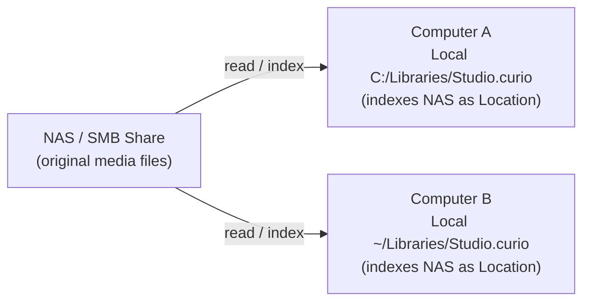

# Windows

Every main Curio window runs in its own operating-system process with its own open library. Keep several libraries open side by side, drag assets between them and isolate background work so a heavy scan in one library never slows another.

## Open window

Launch additional windows from the interface, the system tray or menu bar, or the command line:

- **Open a specific library in a new window**: Open the **Library switcher**, click **⋯** on any closed library and choose **Open in new window**.
- **Open a blank Welcome window**: Choose **Main menu › New window**, or open the Curio tray or menu bar icon and choose **New window**.
- **From a terminal or shortcut**:
  - `curio --library <path-to-.curio>` opens that library in a window.
  - `curio --welcome` opens a new window on the Welcome screen.
  - `curio --tray` starts with the last library hidden in the system tray or menu bar.

Window layouts, themes and global preferences are shared across windows (the window that saves last wins). Changes to the known library list sync to every open window immediately.

## Existing windows

Each library has **one writer** at a time. Because each process runs its own file scanner, thumbnail workers and caches, opening the same library twice would cause conflicting scans and writes.

When a process opens `<name>.curio`, it acquires an OS-level lock on the library folder and records its private local control channel for other Curio processes.

| Situation | What happens |
|---|---|
| You open a library that another Curio window already holds | The existing window comes to the front; no second window opens |
| You launch Curio with no arguments while its last library is already open (or minimized to the tray or menu bar) | That existing window comes back to the front |
| You open a library held by a headless background API process | The background process opens its main window, or hands the library over if an existing window switches to it |
| A Curio process crashes or is force-killed | The operating system releases the library lock automatically so the library opens normally next time |

## Switch windows

- Clicking a library in the **Library switcher** that is open in another window focuses that window instead of switching the current one.
- Clicking **Show `<library>`** in the system tray or menu bar raises that library's window. Choosing **Show all windows** (or left-clicking the tray icon on Windows) brings back every open window.
- Each main window keeps a stable API window ID (visible in [`library.list`](../../api/operations/libraries.md)), even if that window switches to another library.
- **Settings** (++ctrl+comma++) opens one dedicated window per process. Opening it again brings it to the front and jumps to the requested tab.

## Item windows

Open one or more selected assets in a standalone viewer window to inspect or compare them while browsing the grid:

- Press ++shift+alt+w++ (default shortcut for **Open in new window**).
- Middle-click an asset in the grid (default behavior; configurable under **Settings › Controls › Middle click**).
- Right-click selected assets and choose **Open in a window** (or **Open these in a window** when multiple assets are selected).

Inside an item window, step through every asset you opened together and zoom, rotate or play media independently of the main window. Press ++escape++ or double-click to close it.

## Tray & background

### Always on top

Pin any Curio window above other desktop applications with the **Always on top** button in the window title bar or **Main menu › Always on top**. If you hide window chrome buttons under **Settings › General › Window & interface › Window buttons**, **Always on top** stays available in the main menu.

### Window buttons

Window button placement adapts to your operating system and sidebar layout:

- **Windows and Linux**: The minimize, maximize and close buttons sit in a strip above a full-width sidebar on the right edge. When that sidebar is compact or hidden, the buttons sit at the right end of the toolbar instead.
- **macOS**: Curio draws its own close, minimize and zoom buttons on the left. When a full-width sidebar is on the left and starts with a pinned button row (without merged tabs), the buttons sit at the start of that row. If the left sidebar starts with anything else, Curio places them in a strip above it. When no full-width sidebar sits on the left (hidden, docked right or compact), the buttons sit at the left end of the toolbar.

Window buttons belong to the window chrome, not the layout, so **Edit layout** does not move or remove them.

### System tray

By default, closing a window with an open library keeps it running in the background so folder watching, scanning and Auto-Import continue. Change this under **Settings › General › Startup & system › On close**: choose **Minimize to tray** (Windows and Linux) or **Keep in menu bar** (macOS), or choose **Quit**. A window showing the Welcome screen always closes immediately. On Linux desktops without a system tray indicator service (such as `libayatana-appindicator`), closing the window always quits.

Curio shows one tray or menu bar icon regardless of how many windows are open. If the window holding the icon closes, another open window takes over within `2` seconds. The monochrome leaf icon adapts to light or dark taskbars and panels (white on dark, black on light) and draws at native taskbar DPI on Windows.

Under **Settings › General › Startup & system**, enable **Start with system** to launch Curio into the tray or menu bar at login (`--tray`). Curio writes a per-user autostart entry without requiring an installer: `HKCU\Software\Microsoft\Windows\CurrentVersion\Run` on Windows, `~/.config/autostart/curio.desktop` on Linux and `~/Library/LaunchAgents/app.curio.desktop.autostart.plist` on macOS (listed under **System Settings › Login Items › Allow in the Background**).

### Background holders

When the local web API, MCP server or browser extension targets a closed library, Curio spawns a headless background process (`--headless --library <path>`) to serve the request. It also uses background holders to finish interrupted downloads on startup.

- Background holders do not appear in the tray or menu bar menu.
- After `60` seconds with no active jobs, pending thumbnails, downloads or visible notifications, a background holder shuts down automatically.
- Opening that library in the UI promotes or takes over the background holder.

### Quitting

Choosing **Main menu › Quit Curio** (++ctrl+q++) or **Tray › Quit Curio** sends a shutdown request to every open Curio window and every background library holder before exiting.

## Network locations

If your media files live on a NAS, SMB share or file server, keep `<name>.curio` on a **local drive** on each computer and add the mounted network share as an indexed [location](locations.md):

This keeps `library.db`, its SQLite WAL journal and thumbnail caches on local storage with reliable OS file locking while sharing the media files over the network.

## Single-PC limit

!!! warning "Do not open one `.curio` library simultaneously from two computers"
    Opening one `.curio` library from two computers at the same time is **unsupported** and risks database corruption. Do not store an active library on a network share (SMB/NFS) or cloud-sync folder (Dropbox, OneDrive, Syncthing or Google Drive) for concurrent access.

Network filesystems have unreliable advisory locking and caching for SQLite WAL mode, and sync tools can create conflicted copies of `library.db` and `library.db-wal`. If Curio detects that a library folder is stored on a network volume, it shows a startup warning advising you to move the library to a local drive.

To work with one `.curio` library across two computers sequentially, quit Curio completely on the first computer and let syncing finish before opening the library on the second computer.

## Related

- [Create and manage libraries](manage.md): Library switcher, renaming and moving libraries.
- [Add and manage locations](locations.md): Working with mounted network shares and offline drives.
- [Choose a library or window (API)](../../api/connect/routing.md): How the router process forwards API calls across windows and background holders.
