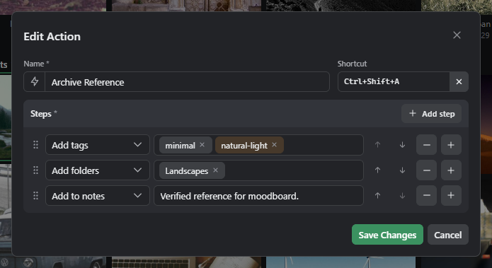

# Actions

Actions are named multi-step workflows saved per library. Run an action with one click or shortcut to apply folders, tags, ratings, notes, URLs, custom fields, rotations, refreshes, trash or plugin programs in order.

<figure class="curio-shot" markdown>

<figcaption>Action editor defining a keyboard-bound multi-step workflow that adds tags, files into a folder and appends notes.</figcaption>
</figure>

## Create & order

Click the **Actions** lightning button in the toolbar (or press ++g++) to open the actions menu:

- **Create**: Click **New action** at the bottom of the menu and enter a **Name** (required). Click the icon button beside it to pick a Tabler icon (defaults to the lightning bolt), optionally record a **Shortcut** and configure one or more **Steps**.
- **Edit, duplicate or remove**: Hover an action in the **Actions** menu and open its overflow menu to **Edit**, **Duplicate** (creates `<Name> copy` directly below with no shortcut so keys do not collide) or **Remove** it.
- **Add, remove and reorder steps**: Click **Add step** at the top of **Steps**, or click **+** or **−** on any row to insert or remove steps (at least one step is required). Drag a step's grip handle or use its up and down buttons to reorder steps. Steps run from top to bottom.

Actions are stored in `<library>.curio/actions.json`, so each library keeps its own workflow set.

## Folders & tags

Six built-in steps manage folder and tag memberships on the selection:

| Step | What it takes | Behavior |
|---|---|---|
| **Add folders** | One or more folders via the folder picker | Adds every selected asset to the chosen folders without removing existing folders |
| **Remove from folders** | One or more folders via the folder picker | Takes every selected asset out of the chosen folders |
| **Clear folders** | Nothing | Removes every selected asset from all folders |
| **Add tags** | One or more tags via the tag picker (can create new tags inline) | Attaches the chosen tags to every selected asset |
| **Remove tags** | One or more tags via the tag picker | Removes the chosen tags from every selected asset |
| **Clear tags** | Nothing | Removes all tags from every selected asset |

Combine **Clear folders** followed by **Add folders** to replace an asset's folder memberships in one action, or **Clear tags** followed by **Add tags** to reset its tags.

## Metadata steps

Five built-in steps edit metadata directly:

| Step | What it takes | Behavior |
|---|---|---|
| **Rating** | `5` down to `1` stars, or **No rating** (`0`) | Sets the star rating on every selected asset |
| **Set notes** | Text | Replaces the notes of every selected asset |
| **Add to notes** | Text | Appends the text on a new line after each asset's existing notes (sets it directly if empty) |
| **Set source URL** | Text | Replaces the source link of every selected asset |
| **Set field** | Searchable field selector and value text | Sets the chosen custom or visible field to that value on every selected asset (creates a manual override for file-backed fields) |

## File steps

Four built-in steps act on previews, orientation or lifecycle:

| Step | Behavior |
|---|---|
| **Rotate** | Rotates each selected asset 90 degrees clockwise, following **Settings › Preview › Image viewer › Rotation** (**View only** or **Save to file**; **Read-only** locations always rotate view-only) |
| **Refresh thumbnail** | Clears cached thumbnails for the selection and queues thumbnail regeneration |
| **Refresh colors** | Re-extracts the dominant color palette for every selected asset |
| **Move to Trash** | Moves the selected assets to Trash (or trashes their membership in the active folder when run inside a folder view, matching ++delete++). See [File operations and trash](file-actions.md) |

## Plugin steps

Any enabled plugin that registers a step program appears in the step type dropdown beneath Curio's built-in steps. When the action runs, Curio executes that plugin program on the selected assets and waits for it to finish before running the next step. Later steps and the window reflect any changes the program makes.

See [Register actions and shortcuts](../../plugins/contributions/actions.md) and [Action and URL program contracts](../../plugins/programs/action-url.md) to build your own plugin steps.

## Run & shortcuts

Select one or more assets in the grid or viewer, then run an action in any of three ways:

1. Click the **Actions** button in the toolbar (or press ++g++) and click the action.
2. Press the action's keyboard shortcut whenever focus is not in a text box.
3. Place the action as a toolbar or sidebar button via **Edit layout** under **Your actions**. See [Arrange the window](../customize/layout.md).

To assign or clear a shortcut inside the action dialog, click the **Shortcut** box and press a key combination. Press ++backspace++ or ++delete++, or click the clear button beside the box, to remove it. If another action or built-in command uses that key combination, the dialog warns you immediately and saving moves the shortcut to this action. All action shortcuts also appear under **Your actions** in **Settings › Shortcuts**, where you can review or rebind them alongside built-in shortcuts.
