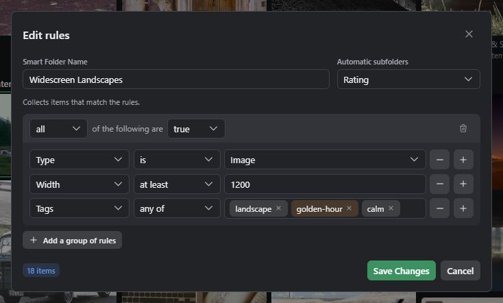

# Smart folders

**Smart Folders** are live folders backed by Curio's [Query language](../../api/query/syntax.md). Assets enter or leave a smart folder whenever their metadata, tags, ratings or custom fields change.

## Create

Create a smart folder in one of two ways:

1. Click **+** beside **Smart Folders** in the sidebar, or right-click an existing smart folder and choose **New smart folder** to nest one inside it.
2. Open **Saved filters** on the **Filter bar** and choose **Save as smart folder** to save your current criteria.

## Scope & nesting

Smart folders can nest to arbitrary depth:

- A top-level smart folder queries every non-trashed asset in the library.
- A nested smart folder narrows its parent chain by evaluating `(parent query) AND (child query)` up to 64 levels deep. The dialog header displays the inherited path.

## Rule groups

<figure class="curio-shot" markdown>

<figcaption>Smart Folder editor combining type, dimension and tag rules with live match counts and Automatic subfolders.</figcaption>
</figure>

The rule editor organizes conditions into `AND`-joined rule groups:

- Click **+** or **−** on rows inside a group to add or remove conditions, and set the group to match **all** (`AND`) or **any** (`OR`) of its rows.
- Use the group header buttons to add or remove sibling groups (joined by `AND`).
- Curio validates rules live as you edit and displays the matching asset count in the footer. Invalid rules show an inline syntax error.

## Automatic subfolders

Any smart folder can expand in the sidebar into live virtual subfolders using **Automatic subfolders** in the editor:

| Built-in grouping | Virtual subfolders generated |
|---|---|
| **Date added (Year)** / **Date added (Month)** | One bucket per import year or `YYYY-MM` month |
| **Date created (Year)** / **Date created (Month)** | One bucket per file creation year or month |
| **Date modified (Year)** / **Date modified (Month)** | One bucket per file modification year or month |
| **Rating** | Unrated and 1–5 star buckets |
| **Type** | Asset types (Images, Videos, Books, Models and others) |
| **Extension** | File extensions (`png`, `jpg`, `mp4` and others) |
| **Tag** | Tags present on matching assets |
| **Indexed custom or plugin field** | Distinct values for that field (such as **Genre**, **Author**, **Series**, **Camera**, **Lens**, **Model** or **LoRA**) |

Virtual subfolders are calculated live when you expand the smart folder in the sidebar. Clicking a bucket filters to assets matching both the smart folder query and that bucket value.

## Container folders

Removing all rule groups shows an empty container card with an **Add a group of rules** button and creates a ruleless smart folder:

- **With Automatic subfolders set**: Groups all assets across the library dynamically, such as *By Camera* grouped by Camera or *Timeline* grouped by **Date created (Year)**.
- **Without Automatic subfolders set**: Collects the union of what its nested child smart folders match.

## Rule types

Visual rule rows cover every searchable property in the library:

- Names, filenames, extensions, MIME types, asset types, file paths, locations and status
- Ratings, Favorite, Explicit, animated flag, pixel dimensions, shape, file size and duration
- Relative and absolute dates (`within`, `before`, `after` and `on`)
- Tags (**any of**, **all of**, **none of** and **exactly**), folders and folder colors
- Palette color matching and geographic `NEAR` / `INSIDE` queries
- All enabled custom and plugin fields, including paired conditions

## Query text

The rule editor compiles to [Query language](../../api/query/syntax.md) text and parses existing queries back into visual rows when reopened. Expressions beyond standard rows (such as nested boolean clauses, regexes or `WITH` paired clauses) remain editable query clauses beside the visual rows so nothing is lost.

## Edit & diagnostics

- Right-click any smart folder in the sidebar to choose **Edit rules**, **New smart folder**, **Change icon**, **Pin** or **Delete**. Deleting a smart folder never deletes or moves assets.
- When a smart folder references a disabled field or plugin, Curio flags it under [`field.usedBy`](../../api/operations/field.md#field-usedby) and **Settings › Fields**.
