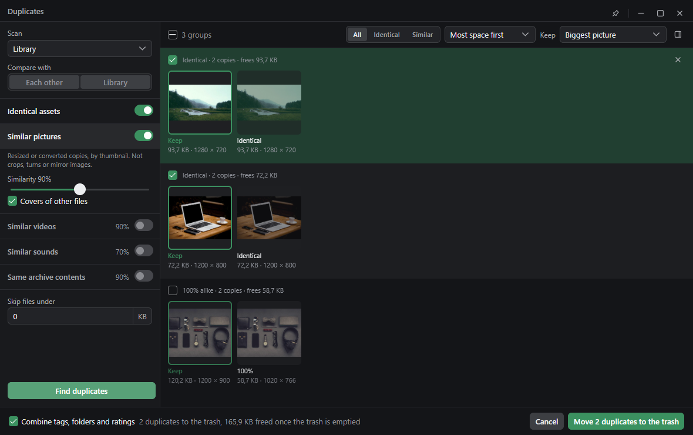

# Duplicates

Open **Find duplicates** from **Main menu › Find duplicates** or by right-clicking a selection and choosing **Find duplicates**. The tool finds exact byte duplicates and visually, audibly or structurally similar assets.

<figure class="curio-shot" markdown>

<figcaption>Find duplicates comparing exact BLAKE3 hashes alongside perceptual image similarity, keep rules and space-reclaim estimates.</figcaption>
</figure>

## Scope

Choose what to scan in the left column of the **Duplicates** window:

| Scope | What is scanned |
|---|---|
| **Library** | Every non-trashed asset in the library compared against every other. |
| **Current folder** | The active folder view in the main window, including its subfolders, search and filters. |
| **Selected** | The assets selected when the Duplicates window opened (chosen automatically from a multi-selection). |
| **Choose folder** | Any library folder and its subfolders picked from the folder picker. |

Assets in **Trash**, companion files grouped inside another asset and missing or offline files are excluded and counted in the summary.

## Compare mode

- **Each other**: Finds duplicates only among the assets inside the chosen scope.
- **Library**: Compares assets in the chosen scope against the entire library, returning only groups that contain at least one asset from your scope.

## Match methods

Turn on any combination of Curio's five comparison methods:

| Method | How it compares | Finds | Does not find |
|---|---|---|---|
| **Identical assets** | Full BLAKE3 hash for files sharing an exact byte size | Exact byte-for-byte copies under any filename or extension | Re-encoded or edited copies |
| **Similar pictures** | Perceptual thumbnail fingerprint (DCT hash, gradient hash and quarter-color balance) | Resized, recompressed and format-converted pictures (plus covers when **Covers of other files** is on) | Crops, rotations, mirrors, recolored edits or different aspect ratios |
| **Similar videos** | Six sampled frames spread across the clip (requires FFmpeg) | Same clip at different resolutions, bitrates or containers | Heavily trimmed or re-edited cuts |
| **Similar sounds** | Acoustic fingerprint of the first minute from audio onset (requires FFmpeg) | Same recording at different bitrates, formats or loudness | Recordings starting at a different offset or live takes |
| **Same archive contents** | CRC-32 and size of every entry inside ZIP, CBZ, EPUB, 7z or CB7 | Repacked or renamed archives, or archives differing by a few entries | Archives whose inner images were recompressed (use *Similar pictures* on covers instead) |

!!! warning "Only *Identical assets* proves byte equality"
    Perceptual methods show candidates for your review. Curio never removes similar assets unless you include their group.

Curio caches hashes and fingerprints in SQLite and invalidates them only when a file or thumbnail changes, so repeat scans finish faster.

## Thresholds

- Each similarity method has its own **Similarity** threshold slider.
- Enable **Covers of other files** under **Similar pictures** to compare books, comics, PDFs, fonts and 3D models by their rendered covers.
- Set **Skip files under** to ignore files below a minimum size in KB.
- Pictures without thumbnails yet are listed as omitted. Run the scan again once background thumbnailing finishes.

## Review groups

Every member in a group matches every other member. Curio avoids transitive chaining so unrelated assets do not merge through an intermediate bridge. Hard links pointing to the same file on disk are labeled **same file** so you know removing one frees no disk space.

- **Row view & Details view**: Click any thumbnail in a group row to mark it as **Keep**. Toggle **Details** in the toolbar to compare the kept copy against another member in side-by-side, slider or difference mode alongside a property comparison table.
- **Included vs excluded**: Groups whose members are all **Identical** start checked (**Included**). Groups with perceptual matches start unchecked until you include them or pick a copy to keep.
- **Keep rule**: Choose an automatic rule in the toolbar (**Biggest picture**, **Largest file**, **Smallest file**, **Added first**, **Added last**, **Best rated**, **Copied into the library**, **Linked in place** or **In a folder**). Click any member to override the rule, or uncheck **Remove** in Details to keep multiple copies.
- **Keyboard navigation**: Use ++up++ and ++down++ to move between groups, ++space++ to toggle inclusion and ++1++–++9++ to keep a member. Press ++ctrl+enter++ to scan or move copies to Trash and ++escape++ to close.

## Skip

Click the **×** button on a group (or on one member in **Details**) to dismiss it from the current results without changing the library. Skipped pairs return on future scans. Click **Select in Curio** in Details to highlight the group's assets in the main window.

## Ignore list

The **Duplicates** window only supports temporary skipping for the current session. To mark assets as **not duplicates** permanently so future scans never group them again, use the [Duplicates API](../../api/operations/duplicates.md#duplicates-ignore). You can clear permanent ignore marks later through the [unignore operation](../../api/operations/duplicates.md#duplicates-unignore).

## Resolve

Click **Move to the trash** and confirm to process every included group:

1. **Safety recheck**: Verifies the kept file exists and identical copies still match byte-for-byte (full bytes up to 8 MiB; sampled above 8 MiB). Changed groups are skipped and reported.
2. **Metadata merge**: When **Combine tags, folders and ratings** is on, Curio copies missing tags, folders, ratings, notes, source URLs and empty user fields onto the kept asset. Existing values and file-extracted metadata stay untouched.
3. **Trash**: Moves non-kept copies to Curio's **Trash** (recoverable with **Restore**). In managed `files/` storage, folders that held removed copies receive hard links to the kept copy and space is freed when you empty Trash. Linked location originals stay on disk.
