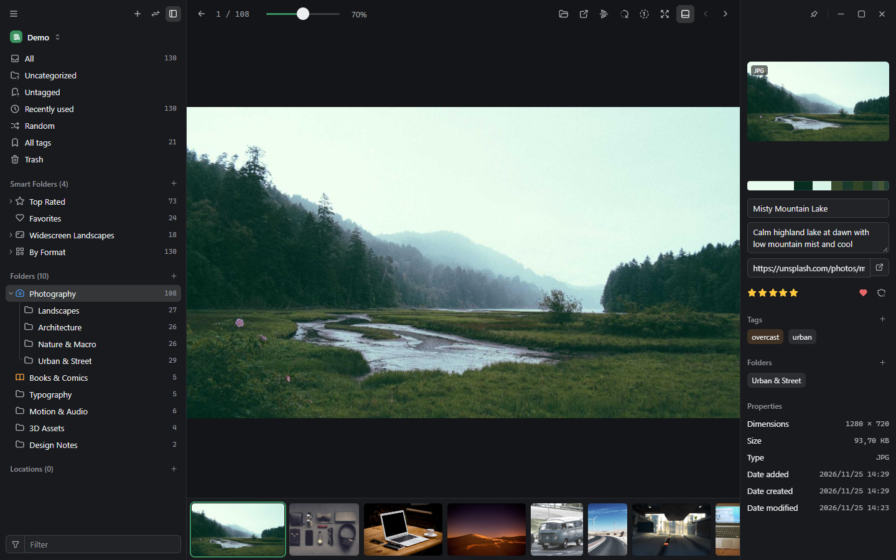

# Images

Curio's image viewer displays still pictures, pixel art, transparent assets, animations, Live Photos and camera RAW + JPEG pairs. Opening a picture places the cached thumbnail at fitted dimensions first, swaps in a window-sized preview decoded in 256 px steps and loads sharper pixels as you zoom in.

<figure class="curio-shot" markdown>

<figcaption>Curio's image viewer showing asset index, logarithmic zoom slider, viewer toolbar controls and Inspector metadata.</figcaption>
</figure>

## Zoom & pan

Zooming is logarithmic from **10%** to **1000%**, so every wheel notch, slider step and zoom drag scales perceived size by the same proportion.

- **Fit to window**: Press ++ctrl+0++ or click **Fit** in the toolbar to fit and recenter the picture. By default, small pictures stay at 100% instead of stretching to fill the stage.
- **Actual size (1:1)**: Click **Actual size** in the toolbar to view pixels at 100%, or click the zoom percentage readout to toggle between **Fit** and **100%**. Change the opening default under **Settings › Preview › Image viewer › Default zoom** (**Fit** or **Original size**).
- **Step zoom**: Press ++ctrl+equal++ or ++ctrl+minus++ (1.25x per press), or drag the zoom slider (snaps to 25%, 50%, 100%, 200% and 400%). You can also use ++ctrl++ + mouse wheel or right-drag up and down (160 px doubles or halves zoom at the pointer).
- **Pan**: Left-drag anywhere on a zoomed picture to pan, or set **Settings › Controls › Mouse wheel in the viewer** to **Pan**. Pan bounds clamp to the picture's edges so the image cannot drift off-screen.
- **Keep zoom across assets**: Turn on **Settings › Preview › Image viewer › Remember zoom** to preserve zoom level and pan position while stepping through assets.

!!! tip "Pre-fetching sharper pixels on zoom"
    When you zoom past the current preview's resolution, Curio requests a preview at twice the needed size (up to 8192 px, or the original file for web-native formats). Details stay sharp as you continue zooming.

## Scaling

Choose how Curio enlarges pixels above 100% in **Settings › Preview › Image viewer › Upscaling**:

- **Smooth** (default): Filtered interpolation suited to photographs and illustrations.
- **Pixelated**: Nearest-neighbor edges suited to pixel art, sprites, icons and UI screenshots.

## Backdrop

Inspect transparent PNG, WebP, GIF, AVIF and SVG assets against either your theme's solid background or a dark checkerboard pattern (24 px tiles).

- Set the default under **Settings › Preview › Image viewer › Transparency** (**Checkerboard** or **Solid**).
- The checkerboard appears only behind the loaded image's bounding box, never across the surrounding stage, so transparent margins remain clear.
- Press ++alt+g++ (or right-click and choose **Black and white**) to check tonal values across images and videos without modifying files.
- Fullscreen mode (++f11++) sets the stage backdrop to black (`#000`) and hides surrounding panels.

## Flip & rotate

Curio supports both temporary on-screen orientation checks and permanent file rotation:

- **Mirror horizontally**: Press ++h++ or click **Mirror** in the toolbar. Mirroring is visual only and resets when you step to another asset.
- **Turn clockwise 90°**: Press ++r++ or click **Turn** in the toolbar. Behavior follows **Settings › Preview › Image viewer › Rotation**:
  - **View only**: Rotates the picture in the viewer without modifying the file on disk. Thumbnails and the Inspector keep the original orientation.
  - **Save to file**: Rewrites supported files on disk (`jpg`, `png`, `bmp` and still `webp`) and refreshes thumbnails and previews. Curio preserves JPEG EXIF and ICC profile blocks as well as PNG text chunks.

!!! warning "Read-only locations and unsupported formats"
    Saving rotation to disk requires write access and applies only to `jpg`, `png`, `bmp` and non-animated `webp`. Other formats and read-only locations stay view-only.

## Animations

Curio detects animated `gif`, `webp` and `apng` files from their headers when they enter the library:

- **Grid and Spectrum views**: Thumbnails show the static first frame by default and animate on hover. Switch **Settings › Controls › Animated images** from **Play on hover** to **Always play** for continuous animation.
- **Inspector preview**: Compact previews stay on the static first frame so hovering the Inspector never restarts playback in the main viewer.
- **Full viewer**: Opening an animated image loads the original file at full resolution.

## Live & RAW

When companion files are grouped into a still photo, dedicated toggle buttons appear in the viewer toolbar:

- **Live Photo**: When an Apple Live Photo `.mov` clip is grouped with its photo, hovering plays the clip in the grid. Clicking **Live Photo** in the viewer plays the motion clip over the still. Click the button again or double-click the clip to stop; playback respects your hover mute setting.
- **RAW / JPEG**: With **Settings › Grouped files › RAW + JPEG** enabled (**Show JPEG** or **Show RAW**), click **RAW / JPEG** to switch between the paired files. Middle-click, **Show in file manager** and **Open with default app** act on whichever file is currently shown.
