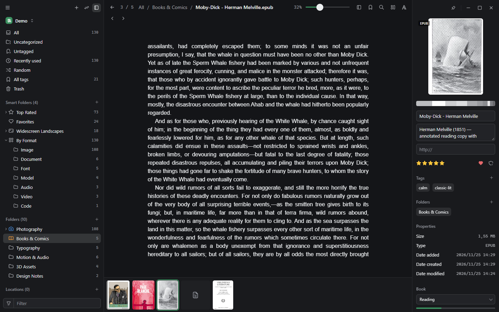

# Reader

Curio's optional **Reader** plugin (`curio.reader`) adds an interactive viewer, cover thumbnailer, bibliographic metadata extractor and reading progress tracker for ebooks, PDFs and comic book archives.

<figure class="curio-shot" markdown>

<figcaption>Curio Reader displaying an EPUB book with the reading progress slider, Reader toolbar controls, cover filmstrip and Book widget.</figcaption>
</figure>

## Install

1. Download `curio-reader` from [**Erehr/curio-plugins**](https://github.com/Erehr/curio-plugins).
2. Open **Settings › Plugins**, click **Add plugin** and select the `curio-reader` folder.
3. Rescan existing books, PDFs and comics in **Settings › Plugins** or **Settings › Fields** to generate covers and metadata.

External plugins added from a folder activate with their requested permissions (`metadata.read`, `metadata.write`, `files.read`, `files.write` and `ui`).

## Formats

| Format family | Extensions | With Reader enabled | Without Reader |
|---|---|---|---|
| **Comics** | `.cbz`, `.cb7` | Comic viewer, cover extraction, page count and ComicInfo metadata | Treated as generic archives; opens in the default app |
| **PDF** | `.pdf` | Interactive reader with text search, outline, appearance themes and cover rendering | Opens in Curio's built-in WebView PDF viewer; thumbnails use `pdftoppm` or the OS thumbnailer |
| **Ebooks** | `.epub`, `.fb2`, `.fbz`, `.mobi`, `.azw3`, `.azw`, `.prc` | Interactive ebook reader with typography controls, table of contents, footnotes, covers and metadata; registered under **Books** | Treated as generic documents; opens in the default app |

When Reader is active, ebooks appear under the **Books** custom type in **Group by › Type**, the **Types** filter and the List **Type** column.

## Reading modes

Switch reading layouts from the Reader toolbar or single-key shortcuts (customizable in **Settings › Shortcuts**):

- **Double page** (++d++): Toggles two-page spread view for comics, magazines and wide screens.
- **Continuous** (++c++): Switches between paginated turns and continuous vertical scrolling.
- **Right to left** (++m++): Flips page order and progress slider direction for manga and RTL publications.

## Comics & grids

- **Fit modes** (++w++): Cycles through fit-to-page, fit-to-width, fit-to-height and actual size, or zooms in and out.
- **Page grid** (++g++) and **Grid style** (++s++): Opens a thumbnail overview of every page in a comic or PDF so you can jump to any spread or chapter.

## Typography

Open the **Appearance** toolbar panel or cycle themes with ++k++:

- **Reflowable ebooks**: Choose installed system fonts, font size, line height, margins, column width, justification and reading color themes (light, sepia, dark or your active Curio theme).
- **PDFs**: Apply page color filters and inversion for dark-mode reading without modifying the PDF file.

## Navigation

- **Sidebar** (++t++): Toggles the slide-out panel with the **Table of Contents**, **Bookmarks** and search hits.
- **Chapter stepping**: Jump to the previous or next chapter with ++shift+[++ (`{`) and ++shift+]++ (`}`).
- **Bookmarks**: Toggle a bookmark on the current page with ++b++, and step between bookmarks with ++[++ and ++]++.
- **In-book search**: Press ++/++ to search full text inside an open ebook or PDF and step between matches.
- **Links and footnotes**: Internal cross-references and popup footnotes open inline while keeping jump history.

## Progress & fields

Reader saves your exact reading position per asset privately (avoiding unnecessary library change events while turning pages) and updates searchable library fields:

| Field key | Label | Type | Notes |
|---|---|---|---|
| `read_state` | Reading status | Single choice | `unread`, `want`, `reading`, `finished`, `dropped` |
| `read_progress` | Progress (%) | Whole number | Updated automatically as you read |
| `pages`, `words` | Pages, Words | Whole number | PDF or comic pages, printed pages or estimated at 1,500 chars/page |
| `title`, `author`, `publisher`, `language`, `isbn`, `identifiers` | Bibliographic metadata | Text | Extracted from EPUB, OPF, PDF and ComicInfo |
| `series`, `series_index` | Series and Number in series | Text + paired Decimal number | Sorting by **Series** breaks ties ascending by **Number in series** |
| `published` | Published | Date | Publication date |
| `genre` | Genre | Multiple choice | Displayed in the **Genres** widget |

Reader also adds three widgets (**Genres**, **Book** and **Series**) placed on the Reader viewer screen and available in the layout editor for any screen.
