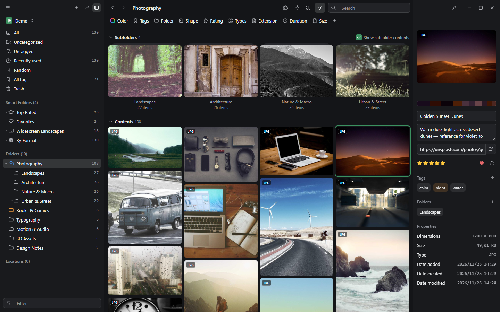

# Curio

A local-first digital asset manager for Windows and Linux, with ad-hoc signed macOS builds. Organize images, video, audio, documents, books, fonts, 3D models, archives, code and web links while your files remain ordinary files on disk.

  <a class="md-button md-button--primary" href="start/install/">Install Curio</a>
  <a class="md-button" href="features/">Explore features</a>
  <a class="md-button" href="api/">API & MCP</a>
  <a class="md-button" href="plugins/">Build plugins</a>

<figure class="curio-shot" markdown>

<figcaption>Curio's main window: Library sidebar with Smart Folders and nested folders, Filter bar, Masonry grid with subfolder cards and photography, and the Inspector with color palette, notes, source link, ratings, tags, folders and properties.</figcaption>
</figure>

## Why Curio

Curio is an open-source (GNU GPL v3) alternative to proprietary asset managers such as Eagle, built on a Rust and SQLite engine with a Tauri 2 desktop window. Your files stay accessible from any file manager: index existing folders in place, or copy assets into a `.curio` library whose `files/` folder mirrors your library folders with hard links.

-   :lucide-hard-drive: **Filesystem-first storage**

    ---

    Index existing folders where they live with **Read-only**, **Edit files** or **Edit and organize** access, or copy files into managed storage whose `files/` tree mirrors library folders with real filenames and hard links.

    [Storage & locations](features/libraries/storage.md)

-   :lucide-palette: **Visual browsing & Spectrum**

    ---

    Switch between Grid, Masonry, Justified, List and the interactive **Spectrum** color map. Group assets by type, date, rating, extension, size, location or custom fields, and pin favorite folders and locations.

    [Views & Spectrum](features/browse/views.md)

-   :lucide-search: **Query language & Smart Folders**

    ---

    Combine prefix text search, filter chips, palette color matching, geographic `NEAR`/`INSIDE` queries, paired field filters (`WITH`) and nested Smart Folders with live **Automatic subfolders**.

    [Query language](api/query/syntax.md) · [Smart folders](features/search/smart-folders.md)

-   :lucide-eye: **Built-in viewers & optional format plugins**

    ---

    View images, RAW photos, Live Photos, video with subtitles, audio waveforms, Markdown, code, web links and variable fonts. Add optional plugins for books, PDFs, comics, 3D models and AI generation metadata.

    [Supported formats](features/viewer/formats.md)

-   :lucide-plug: **Local API & built-in MCP server**

    ---

    One loopback server (`127.0.0.1:41733`) serves HTTP JSON and binary endpoints, a zero-dependency JavaScript/TypeScript client (`curio.js`), Server-Sent Events, browser capture pairing and a Streamable HTTP MCP server for AI assistants.

    [API overview](api/index.md) · [MCP setup](api/connect/mcp.md)

-   :lucide-puzzle: **Sandboxed plugin platform**

    ---

    Extend Curio with `plugin.json` manifests, sandboxed HTML/JS pages (widgets, tabs, windows, viewers, thumbnailers and extractors) and external programs with scoped run tokens and per-library permissions.

    [Plugin guide](plugins/index.md) · [Manifest reference](plugins/manifest/index.md)

## Get started

Curio is a native desktop application with no account, cloud sync or telemetry:

| Platform | Packages | Runtime notes |
|---|---|---|
| **Windows** | NSIS per-user installer (`Curio_<version>_x64-setup.exe`) and portable ZIP (`Curio-<version>-windows-x64-portable.zip`) | Bundles WebView2 bootstrapper and FFmpeg (BtbN GPL shared build). No admin rights needed. |
| **Linux** | Debian/Ubuntu (`.deb`), Fedora/openSUSE (`.rpm`) and AppImage (`.AppImage`) | Uses system WebKitGTK 4.1, GStreamer (`gst-libav`) and FFmpeg. AppImage bundles GStreamer plugins. |
| **macOS** | `.dmg` builds for Apple Silicon and Intel (ad-hoc signed, not notarized) | Needs macOS 12 Monterey or later with Safari 16.4 or later; bundles FFmpeg (Martin Riedl static GPL build). Run `xattr -cr /Applications/Curio.app` once after copying to `/Applications`. |

Start with [Install](start/install.md) to set up an installed or portable copy, then follow [First library](start/first-library.md) to import your first folder, tag assets and run a search.

## Features

The **Features** guide covers every desktop workflow:

-   **Libraries, storage & backups**

    ---

    Manage multiple libraries in separate windows, configure in-place locations, move assets across libraries and run scheduled SQLite backups with integrity checks.

    [Libraries & files](features/libraries/manage.md)

-   **Import, capture & export**

    ---

    Drag and drop files, capture images and pages with the **Send to Curio** browser extension or userscript, watch folders with Auto-Import rules, migrate Eagle `.library` folders and export sidecars.

    [Import & export](features/import/files.md)

-   **Organize & inspect**

    ---

    Use nested folders, tags and tag groups, favorites and explicit flags, custom typed fields, file metadata readers, grouped files and reusable multi-step actions.

    [Organize](features/organize/folders.md)

-   **Tools & customization**

    ---

    Run Batch rename with token rules, find exact and perceptual duplicates across five methods, compare two pictures side by side, dock zones and customize themes and shortcuts.

    [Tools](features/tools/rename.md) · [Customize](features/customize/layout.md)

## API & MCP

Curio exposes one operation registry over four transports, so scripts, browser extensions, plugins and AI assistants share the same operation names, schemas and permission checks:

- **HTTP API (`POST /api/v1/<namespace>/<method>`)**: Call 164 operations on `http://127.0.0.1:41733`, upload binaries and stream live updates over Server-Sent Events (`POST /api/v1/events`). See [Web API and service discovery](api/connect/http.md).
- **JavaScript & TypeScript client (`curio.js`)**: Served by the running app at `/api/v1/curio.js` with TypeScript definitions at `/api/v1/curio.d.ts`. Works in browsers, Node.js, userscripts (`GM_xmlhttpRequest`), browser extensions and plugin pages. See [JavaScript and TypeScript client](api/connect/client.md).
- **Model Context Protocol (`POST /mcp`)**: Turn on the built-in Streamable HTTP MCP server in **Settings › MCP** and choose which tools and token permissions an AI assistant may use. See [Connect an MCP client](api/connect/mcp.md).
- **Browser capture markup**: Add `data-curio-*` attributes or listen for `curio:collect` on web pages and userscripts to pass high-resolution files and metadata to Send to Curio. See [Web page and userscript capture contract](api/connect/browser-markup.md).

## Plugins

A plugin is a folder containing `plugin.json` plus any optional HTML pages or helper programs. A single plugin can combine declarative JSON and interactive code:

- **Fields, readers, filters, sorts & columns**: Declare typed custom fields, extract metadata with PNG text chunks, regex, companion JSON pointers, hidden HTML pages or CLI commands, and use values in filters, sorts, Group by and list columns.
- **UI surfaces**: Add Inspector or sidebar widgets, main-window tabs, standalone windows, custom format viewers with native toolbar controls and shortcuts, and Settings pages styled with Curio's theme tokens.
- **Automation & external tools**: Register item actions, URL handlers and background jobs that run bundled programs or discovered system tools (`ffmpeg`, `ffprobe`, `yt-dlp`, `gallery-dl`, `exiftool`, `magick`, `7z`).

Start with [Choose a plugin extension point](plugins/index.md) or build a starter plugin in [Create and load a plugin](plugins/start/first-plugin.md).

## Help

- **Terminology**: See [Curio terminology](start/terms.md) for how libraries, locations, folders, grouped files and screens differ.
- **Troubleshooting**: Diagnose missing files and pending operations in [Recover files and library data](features/help/storage.md), background queues in [Indexing, previews and performance](features/help/performance.md) and API/MCP/plugin issues in [Fix connection and plugin problems](features/help/connections.md).
- **Repositories**: Source code and releases are on GitHub at [**Erehr/curio**](https://github.com/Erehr/curio) (desktop app), [**Erehr/curio-plugins**](https://github.com/Erehr/curio-plugins) (Reader, 3D models and AI generation) and [**Erehr/curio-extension**](https://github.com/Erehr/curio-extension) (Send to Curio browser extension).
- **License**: Curio (the desktop application, `curio.js`, starter templates and documentation examples) is free software under the **GNU General Public License v3.0**.
