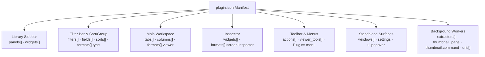

# Plugins

Curio's plugin system extends both the library engine and the desktop window, from declarative metadata readers and saved filters to HTML/WebGL format viewers and native CLI programs.

## Capabilities

A plugin is a folder containing a `plugin.json` manifest plus optional HTML/CSS/JS pages, localization files (`locales/<lang>.json`) and helper scripts or binaries.

-   **Metadata & organization**

    ---

    Declare typed custom fields (single, multi-value, paired and grouped ranges), extract values from files or companions and surface them in filters, sorts, Group by and list columns.

    [Fields](contributions/fields.md) · [Metadata readers](contributions/extractors.md) · [Search, filters & sorts](contributions/search.md) · [Columns & Group by](contributions/display.md)

-   **Custom UI surfaces**

    ---

    Build Inspector or sidebar widgets, main-window tabs, standalone windows, anchored popovers and Settings pages that inherit Curio's live theme tokens and dark/light mode.

    [Widgets](contributions/widgets.md) · [Windows, tabs & settings](contributions/surfaces.md) · [Page runtime](pages/runtime.md) · [Appearance](pages/appearance.md)

-   **Formats, companions & viewers**

    ---

    Register file extensions and custom display types (`formats[].type`), group companion files into one item, generate custom thumbnails and replace Curio's viewer with a custom page plus native toolbar controls and shortcuts.

    [Formats & viewers](contributions/formats.md) · [Companion files](contributions/companions.md) · [Viewer controls](pages/viewer-tools.md)

-   **Actions, URLs & background tools**

    ---

    Add commands to item menus, toolbars, viewers and reusable action steps; intercept dropped or pasted URLs; and run external programs or system tools (`ffmpeg`, `yt-dlp`, `exiftool`, `magick`, `7z`) as cancellable jobs.

    [Actions & shortcuts](contributions/actions.md) · [URL handlers](contributions/urls.md) · [Programs](programs/runtime.md) · [Jobs & tools](programs/jobs.md)

## Building blocks

One `plugin.json` can combine all three implementation styles. Start declaratively and add pages or programs only where needed:

| Mechanism | When to use it | Sandbox & execution |
|---|---|---|
| **Declarative JSON** (`fields`, `extractors` with `png_text`/`regex`/`json`, `filters`, `sorts`, `panels`, `columns`, `companions`, `formats[].open`, `widgets[].fields`, `theme_variables`) | No custom UI or external binaries needed. Runs directly in Rust with no startup overhead. | Executed by Curio's Rust engine; needs no `exec` or `network` permissions. |
| **HTML/JS pages** (`widgets[].page`, `tabs`, `windows`, `settings`, `formats[].viewer`, `formats[].thumbnail_page`, `extractors[].page`, `ui.popover`) | Interactive UI, custom viewers (Canvas, WebGL, pdf.js, foliate-js), browser-side decoding or visual tools. | Sandboxed iframe on a per-plugin origin (`plugin://` on Linux and macOS, `http://plugin.<id>.localhost/` on Windows) talking through `curio.js` over the host postMessage bridge. |
| **Native programs** (`actions[].run`, `urls[].run`, `extractors[].command`, `formats[].thumbnail.command`, `process.run`) | File conversion, Python/Node/Rust CLIs or external tools like `ffmpeg` or `yt-dlp`. | Spawned directly as a child process with `CURIO_API_URL`, a scoped run token (`CURIO_API_TOKEN`) and `CURIO_PLUGIN` in its environment. |

## By task

| Goal | Extension point(s) | Start here |
|---|---|---|
| Add searchable properties read from PNG chunks, JSON sidecars or files | `fields[]` + `extractors[]` | [Register indexable fields](contributions/fields.md) · [Register a metadata reader](contributions/extractors.md) |
| Add sidebar query lists, filter bar chips, sorts or Group by choices | `filters[]`, `sorts[]`, `panels[]`, `fields[].own_filter`, `formats[].type` | [Add searches, filters, sorts and panels](contributions/search.md) · [Add columns and Group by choices](contributions/display.md) |
| Show custom readouts or controls for selected items | `widgets[]` (field list or HTML page) | [Register an Inspector or sidebar widget](contributions/widgets.md) |
| Build a full-screen workspace tab or standalone tool window | `tabs[]` or `windows[]` | [Register windows, tabs and settings pages](contributions/surfaces.md) |
| Support a new file type with thumbnails and a custom viewer | `formats[]`, `viewer_tools[]`, `viewer_keys[]` | [Register a format and viewer](contributions/formats.md) · [Build viewer controls and shortcuts](pages/viewer-tools.md) |
| Keep related files (such as `.obj` + `.mtl` or model + preview) in one item | `formats[].companions[]` | [Register files that form one item](contributions/companions.md) |
| Run a script or open a tool on selected items, or as a step in reusable actions | `actions[]` | [Register actions and shortcuts](contributions/actions.md) |
| Intercept dropped, pasted or browser-sent URLs from a specific site | `urls[]` | [Register URL handlers](contributions/urls.md) |
| Run FFmpeg, yt-dlp, ExifTool or a custom CLI with live progress | `tools[]` + `process.run` + `job.*` | [Long-running jobs and tools](programs/jobs.md) |

## Surfaces

## API access

Inside any plugin page or program, `Curio.connect()` connects automatically without manual credentials. It uses the same [API](../api/index.md) as external scripts, scoped to the plugin's library and granted permissions, plus plugin-only operations:

- `plugin.state.*`, `plugin.itemState.*`, `plugin.settings.*`, `plugin.log`, `plugin.close`
- `item.fileUrl`, `item.previewUrl`, `item.writeUrl`, `archive.entryUrl`
- `viewer.setTools`, `ui.choose`, `ui.popover`, `process.run`, `job.start` / `update` / `finish` / `cancel`
- Page-local lifecycle and interaction hooks (`plugin.run`, `plugin.item`, `plugin.selection`, `plugin.drop`, `plugin.tool`, `plugin.thumbnail`, `plugin.extract`; see [Page-local hooks](hooks/lifecycle.md)).

## Examples

- **Starter templates**: Open **Settings › Plugins › New example plugin** to generate any of six templates (**Window**, **Tab**, **Widget**, **Format viewer**, **Program**, **URL handler**). See [Create and load a plugin](start/first-plugin.md) and [Starter templates](examples/starters.md).
- **Curio's optional plugins**: Study how **Reader**, **3D models** and **AI generation** implement archive streaming, WebGL thumbnailers, viewer toolbars, companion rules and paired field queries in [Curio's optional plugins](examples/curio.md).
- **Demonstration plugins**: Explore eight focused examples (image conversion, CSV tables, UI gallery, link catcher, text notes, review workflow, shape tagger and library stats) in [Demonstration plugins](examples/demos.md).
- **Manifest reference**: Look up every key in [`plugin.json` manifest reference](manifest/index.md).
