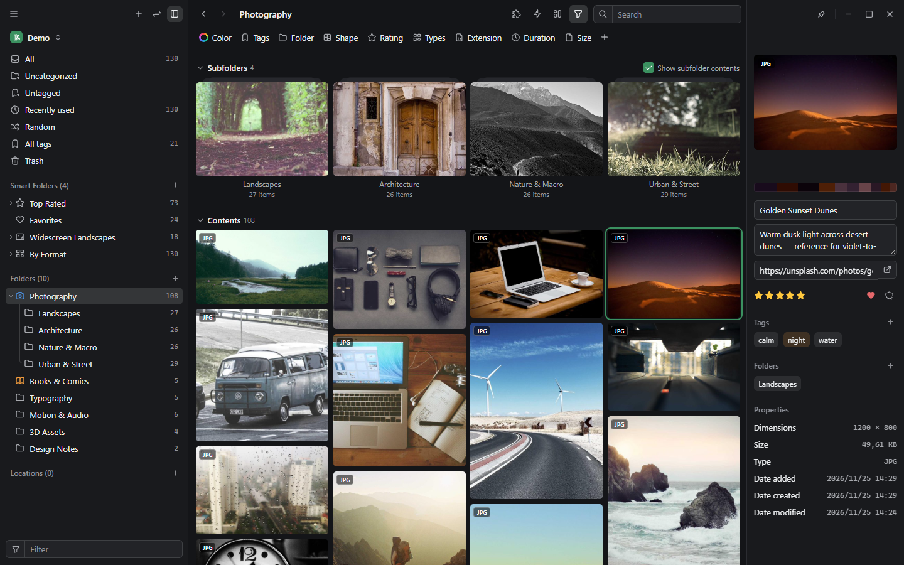
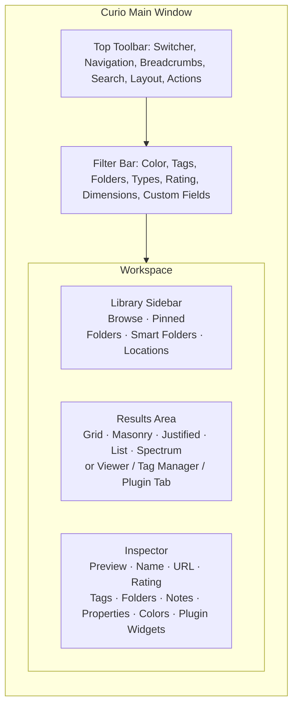

# Window

Curio's main window is built from rearrangeable **zones** and **widgets**. You can use the default layout as is or dock, collapse and rearrange panels to fit landscape or portrait screens.

<figure class="curio-shot" markdown>

<figcaption>Default four-zone layout: Library sidebar (left), top toolbar and Filter bar, scrollable asset grid and Inspector (right).</figcaption>
</figure>

## Welcome & switcher

When no library is open (on first launch, with `--welcome`, or after removing the current library from your list), Curio shows the **Welcome** screen:

- **Create new library** and **Open an existing library** buttons.
- Your **recent libraries** list with each library's icon, color, path and online/offline status.
- Drag-and-drop support for opening an existing `.curio` folder or importing files directly onto the window.

Once a library is open, the **Library switcher** sits at the start of the top toolbar. Click it to switch libraries, open another library in a new window, create a library, change a library's name, icon or color, or remove a library from the list without deleting its folder on disk.

## Toolbar

The top **Toolbar** holds common controls:

- **Menu**: File operations, tools (**Batch rename**, **Find duplicates**, **Compare**), Plugins menu, **Edit layout** and **Settings**.
- **Back and forward** (++alt+left++ / ++alt+right++): Step through browsing history. While the viewer is open, **Back** closes it first.
- **Breadcrumb**: Shows the current scope (such as a nested folder path or location directory). Click any parent segment to jump up the tree.
- **Search** (++ctrl+f++): Accepts plain words, prefix queries and [Query language](../api/query/syntax.md) expressions, with a menu to choose which fields plain text searches.
- **Filters**, **Layout** (Grid, Masonry, Justified, List, Spectrum, thumbnail size slider, captions, Sort by, Group by, Show subfolders and Show subfolder contents) and **Library / Inspector** toggles.

Move, hide or add widgets (including plugin buttons) in [Arrange the window](../features/customize/layout.md).

## Sidebar

The left **Library** sidebar is shared across browsing screens and organized into collapsible sections:

| Section | What it shows |
|---|---|
| **Browse** | **All**, **Favorites**, **Uncategorized** (assets in no library folder, excluding full in-place locations), **Untagged**, **Recently used**, **Random**, **All tags** (opens the Tag Manager), **Missing & offline** and **Trash**. |
| **Pinned** | Drag-reorderable shortcuts to favorite folders, smart folders, tags and location directories. |
| **Folders** | Hierarchical library folders with asset counts, optional icons and colors, auto-tags and drag-and-drop filing. |
| **Smart Folders** | Saved live queries that can nest and optionally expand into virtual **Automatic subfolders**. |
| **Locations** | Disk folders indexed in place, expandable into subdirectories, with online/offline status and access badges. |
| **Plugin panels** | One-click query lists or sidebar widgets added by enabled plugins. |

Switch the sidebar between **Full**, **Compact** (icon rail), **Hidden** and **Edge-hover** auto-reveal, or dock it on the left or right.

## Results & Inspector

- **Filter bar**: Sits above the results. Click any chip (**Color**, **Tags**, **Folder**, **Types**, **Extension**, **Shape**, **Rating** with Favorite and Explicit toggles, **Size**, **Duration**, **Dates**, **Note**, **URL** or enabled custom fields) to narrow the view. Save combinations under **Saved filters**, or toggle **Lock filter** so active filters stay on when switching folders.
- **Results area**: Displays subfolder cards (optional) followed by assets in **Grid**, **Masonry**, **Justified**, **List** or **Spectrum** view. Supports range selection (++shift+click++), multi-selection (++ctrl+click++), drag-and-drop to folders, tags or external apps, and hover previews for video, audio, animated images and Live Photos.
- **Inspector**: Shows details for the selected asset, or a multi-selection summary when several assets are selected. By default it includes Preview, Name, Notes, Source URL, **Rating** (stars, Favorite heart and Explicit toggle), Tags, Folders, Properties, Colors, Files (for grouped files) and active plugin widgets (such as Camera EXIF, Font metrics, Book metadata, 3D Geometry or AI generation prompts).

## Extra windows

Curio opens secondary windows when you want reference material or tools beside your library:

- **Asset windows**: Right-click an asset (or press ++shift+alt+w++) and choose **Open in a window** to keep a reference image, video, book or model open alongside the main grid, with optional **Always on top**.
- **Built-in tool windows**: **Batch rename**, **Find duplicates** and **Compare** open in focused windows that stay synced with your library.
- **Plugin windows and tabs**: Plugins can open standalone windows or register tabs beside the main grid and Tag Manager.
- **Settings window** (++ctrl+comma++): Opens in a searchable window covering all 16 Settings pages. Library-scoped pages (**Storage**, **Backup**, **Auto-Import**, **Grouped files** and **Fields**) display the active library's name in their header when multiple libraries exist.

## Commands & shortcuts

- **Context menus**: Right-click assets, folders, tags, locations, group headers or empty grid space for contextual commands.
- **Keyboard shortcuts**: Open **Settings › Shortcuts** to search app, viewer, user action and plugin shortcuts, inspect defaults or record custom bindings. See [Keyboard and mouse reference](../features/customize/shortcuts.md).
- **Reusable actions**: Combine multi-step edits (tags, folders, ratings, custom fields, rotations and plugin programs) into one-click or shortcut-triggered workflows in [Build reusable actions](../features/organize/actions.md).
